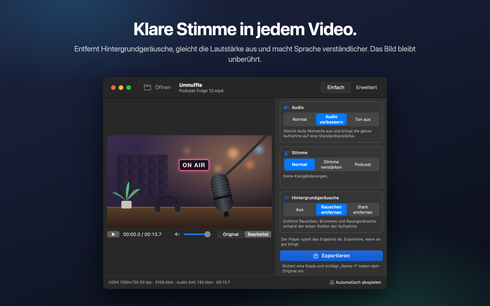
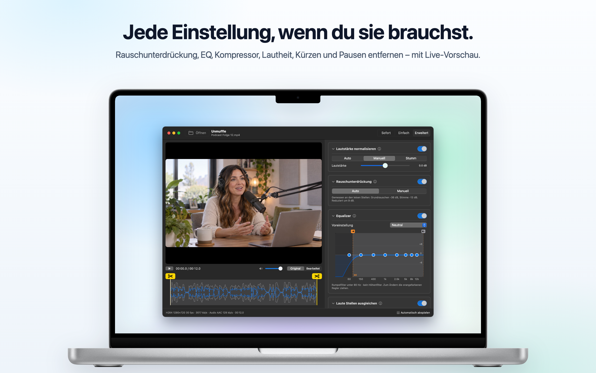
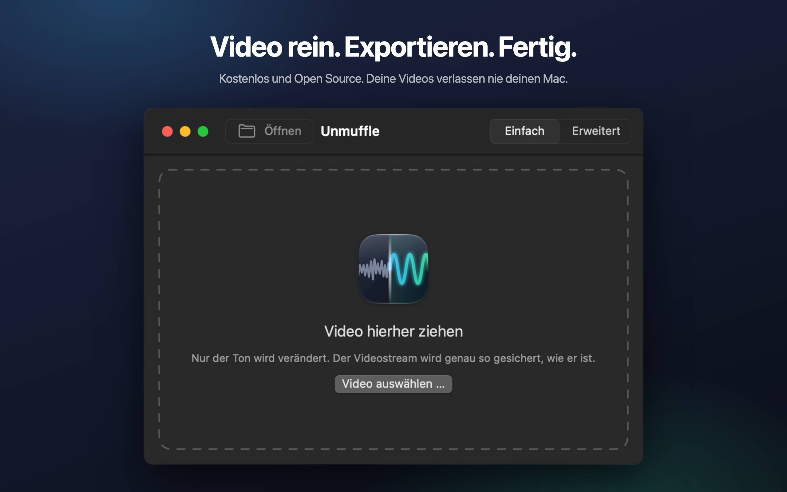

<h1 align="center">Unmuffle</h1>

<b>Die Stimme in jedem Video bereinigen.</b> 
Eine kleine, kostenlose Mac-App, die Hintergrundgeräusche entfernt, die Lautstärke ausgleicht und Sprache verständlicher macht. 
Das Bild bleibt unberührt.

  
  
  
  

  
  &nbsp;
  

Apple Silicon und Intel · macOS 14 oder neuer · Von Apple notarisiert

🌐 <b>Deutsch</b> · 13 weitere Sprachen

 
🇺🇸&nbsp;<a href="README.md">English</a>&nbsp;&nbsp;·&nbsp; 🇪🇸&nbsp;<a href="README.es.md">Español</a>&nbsp;&nbsp;·&nbsp; 🇫🇷&nbsp;<a href="README.fr.md">Français</a>&nbsp;&nbsp;·&nbsp; 🇮🇹&nbsp;<a href="README.it.md">Italiano</a>&nbsp;&nbsp;·&nbsp; 🇧🇷&nbsp;<a href="README.pt-BR.md">Português</a>&nbsp;&nbsp;·&nbsp; 🇳🇱&nbsp;<a href="README.nl.md">Nederlands</a>&nbsp;&nbsp;·&nbsp; 🇵🇱&nbsp;<a href="README.pl.md">Polski</a> 
🇷🇺&nbsp;<a href="README.ru.md">Русский</a>&nbsp;&nbsp;·&nbsp; 🇹🇷&nbsp;<a href="README.tr.md">Türkçe</a>&nbsp;&nbsp;·&nbsp; 🇯🇵&nbsp;<a href="README.ja.md">日本語</a>&nbsp;&nbsp;·&nbsp; 🇰🇷&nbsp;<a href="README.ko.md">한국어</a>&nbsp;&nbsp;·&nbsp; 🇨🇳&nbsp;<a href="README.zh-Hans.md">简体中文</a>&nbsp;&nbsp;·&nbsp; 🇹🇼&nbsp;<a href="README.zh-Hant.md">繁體中文</a>

## Was Unmuffle macht

Zieh eine Bildschirmaufnahme, einen Vlog oder einen Videoanruf hinein. Unmuffle bereinigt den Ton und sichert eine Kopie.
Das Original bleibt, wie es war.

<table>
<tr>
<td width="33%" valign="top">
<h3>🔇 Entfernt Störgeräusche</h3>
Rauschen, Brummen und Raumgeräusche. Die starke Einstellung schaltet auch die Pausen zwischen Wörtern stumm.
</td>
<td width="33%" valign="top">
<h3>🎙️ Klarere Stimme</h3>
Gleicht laute Momente aus, bringt die Aufnahme auf eine Standardlautstärke und kann den Sprachbereich anheben.
</td>
<td width="33%" valign="top">
<h3>🎬 Bild bleibt unberührt</h3>
Der Videostream wird Byte für Byte kopiert, solange du nichts schneidest.
</td>
</tr>
<tr>
<td valign="top">
<h3>✂️ Kürzt Videos</h3>
Zieh die Griffe, um zu kürzen, oder lass Unmuffle die leisen Stellen finden und herausschneiden.
</td>
<td valign="top">
<h3>🔒 Privat</h3>
Alles passiert auf deinem Mac. Nichts wird hochgeladen, und es gibt weder Konten noch Tracking.
</td>
<td valign="top">
<h3>🔄 Aktualisiert sich selbst</h3>
Gibt es eine neue Version, sagt dir ein Banner Bescheid. Ein Klick installiert sie.
</td>
</tr>
</table>

<table>
<tr>
<td></td>
<td></td>
</tr>
<tr>
<td align="center">Der Modus „Erweitert“ zeigt alle Einstellungen</td>
<td align="center">Zieh ein Video hinein, um loszulegen</td>
</tr>
</table>

## Installation

**Mac App Store:** Hol dir [Unmuffle im Mac App Store](https://apps.apple.com/app/unmuffle/id6825195286).
Der App Store hält die App aktuell.

**GitHub:**

1. Lade [`Unmuffle.zip`](https://github.com/iAlborz/Unmuffle/releases/latest/download/Unmuffle.zip) herunter
   und zieh `Unmuffle.app` in den Ordner „Programme“. Alles, was die App braucht, ist schon enthalten.
2. Öffne die App. Sie ist von Apple notarisiert, deshalb öffnet macOS sie ohne Warnung.

Ab Version 1.3 aktualisiert sich die GitHub-Version selbst. Gibt es eine neue Version, erscheint oben im
Fenster ein Banner. Klicke auf **Aktualisieren** und Unmuffle lädt sie herunter, installiert sie und
startet neu. Du kannst auch jederzeit **Unmuffle → Nach Updates suchen …** wählen.

## Bedienung

Der **Sofort-Modus** ist am schnellsten. Zieh ein oder mehrere Videos ins Fenster (oder drück ⌘O). Jedes
wird mit den Optionen rechts bereinigt und als `Name-1.mp4` neben dem Original gesichert. Es gibt nichts
zu bestätigen. Die Version aus dem Mac App Store fragt einmal pro Ordner, ob sie dort sichern darf.

Zieh ein Video ins Fenster (oder drück ⌘O). Im Modus „Einfach“, der Standardeinstellung, spielt Unmuffle
das Video gleich mit der Bereinigung ab. So hörst du das Ergebnis sofort. Klicke auf **Exportieren** und
bestätige den Speicherort. Vorgeschlagen wird `Name-1.mp4` neben dem Original (danach `Name-2` und so
weiter). Schalte **Automatisch abspielen** unten rechts aus, wenn du die Wiedergabe lieber selbst startest.

Der **Modus „Einfach“** hat drei Optionen, die zusammenwirken:

- **Audio:** so lassen, wie es aufgenommen wurde; laute Momente ausgleichen und auf eine Standardlautstärke
  bringen; oder stummschalten.
- **Stimme:** keine Änderung; den Sprachbereich anheben, damit sich die Stimme durchsetzt; oder ein vollerer
  Podcast-Klang.
- **Hintergrundgeräusche:** aus; Rauschen, Brummen und Raumgeräusche entfernen; oder stark entfernen und
  die Pausen zwischen Wörtern stummschalten.

Die Optionen bleiben eingestellt, solange die App geöffnet ist. Ein ganzer Stapel Aufnahmen heißt also:
Reinziehen, Exportieren, Reinziehen, Exportieren.

<b>Modus „Erweitert“</b>

- Rauschunterdrückung, Noise Gate, Rumpel- und Höhenfilter, ein 8-Band-Equalizer, ein Kompressor,
  Verstärkung und Lautheitsnormalisierung. Jede Karte hat eine ⓘ-Taste, die ihre Einstellungen erklärt.
- **Rauschen erkennen** misst das Grundrauschen und den Sprachpegel und setzt sinnvolle Werte.
- Schalte den Player zwischen **Original** und **Bearbeitet** um. „Bearbeitet“ schickt den Ton ab dem
  Abspielkopf durch dieselbe ffmpeg-Filterkette, die auch beim Exportieren zum Einsatz kommt. Änderst du
  während der Wiedergabe eine Einstellung, folgt der Ton einen Moment später.
- Der EQ ist eine Grafik mit acht Punkten. Zieh einen Punkt nach oben oder unten; ein Doppelklick setzt
  ihn zurück.
- Zum Kürzen ziehst du die gelben Griffe mit dem Scherensymbol an der Wellenform.
- **Leise Stellen entfernen** sucht nach Pausen. Rote Blöcke werden herausgeschnitten. Klicke auf einen
  Block, um die Stelle zu behalten.

<b>So funktioniert die Rauschunterdrückung</b>

Für die Rauschunterdrückung sorgt `afftdn` aus ffmpeg, ein spektraler Rauschfilter (FFT). Er verfolgt das
Rauschprofil laufend, während der Ton spielt. „Rauschen erkennen“ misst die leisen Stellen, die es auf der
Zeitleiste findet, und nimmt deren Medianpegel als Grundrauschen. Dann legt es die Stärke der Reduzierung
anhand des Abstands zwischen Grundrauschen und Stimmpegel fest.

<b>Videoqualität</b>

- Ohne Schnitte wird der Videostream **unverändert kopiert** (Stream Copy). Er ist Byte für Byte identisch
  mit der Quelle.
- Kürzen oder Pausen entfernen ändert die Zeitleiste, deshalb muss das Video neu codiert werden. Der
  Hardware-Videoencoder des Mac codiert es mit demselben Codec und derselben Bitrate wie die Quelle neu.
  „Verlustfrei schneiden“ schneidet stattdessen an Keyframes, ohne neu zu codieren. Die Schnittpunkte
  können dabei um ein paar Frames abweichen.

## Für Entwickler

Wie du Unmuffle aus dem Quellcode baust, eine Version veröffentlichst oder etwas beiträgst, steht in der
[englischen README](README.md#build-from-source). Issues und Pull Requests sind willkommen.

## Datenschutz

Unmuffle sammelt keine Daten, und deine Videos verlassen nie deinen Mac. Die GitHub-Version fragt etwa
einmal am Tag bei GitHub nach einer neuen Version; die App-Store-Version baut keine Netzwerkverbindungen
auf. Mehr dazu in der [Datenschutzerklärung](PRIVACY.md) (auf Englisch).

## Lizenz

[MIT](LICENSE). Verwende es, ändere es, forke es, veröffentliche es.

Unmuffle enthält [FFmpeg](https://ffmpeg.org) 9.0.2, lizenziert unter der
[LGPL 2.1 oder später](https://www.gnu.org/licenses/old-licenses/lgpl-2.1.html). Es wird mit
[`scripts/build-ffmpeg.sh`](scripts/build-ffmpeg.sh) aus dem unveränderten offiziellen Quellcode gebaut,
ohne GPL- oder unfreie Komponenten, und liegt als separate Bibliotheken in der App. Der Lizenztext liegt
in der App unter `Contents/Resources/FFmpeg-LICENSE.txt`. FFmpeg ist eine Marke von Fabrice Bellard.

Die GitHub-Version enthält [Sparkle](https://sparkle-project.org) für Updates, unter der
[MIT-Lizenz](https://github.com/sparkle-project/Sparkle/blob/2.x/LICENSE). Der Lizenztext liegt in der
App unter `Contents/Resources/Sparkle-LICENSE.txt`.
