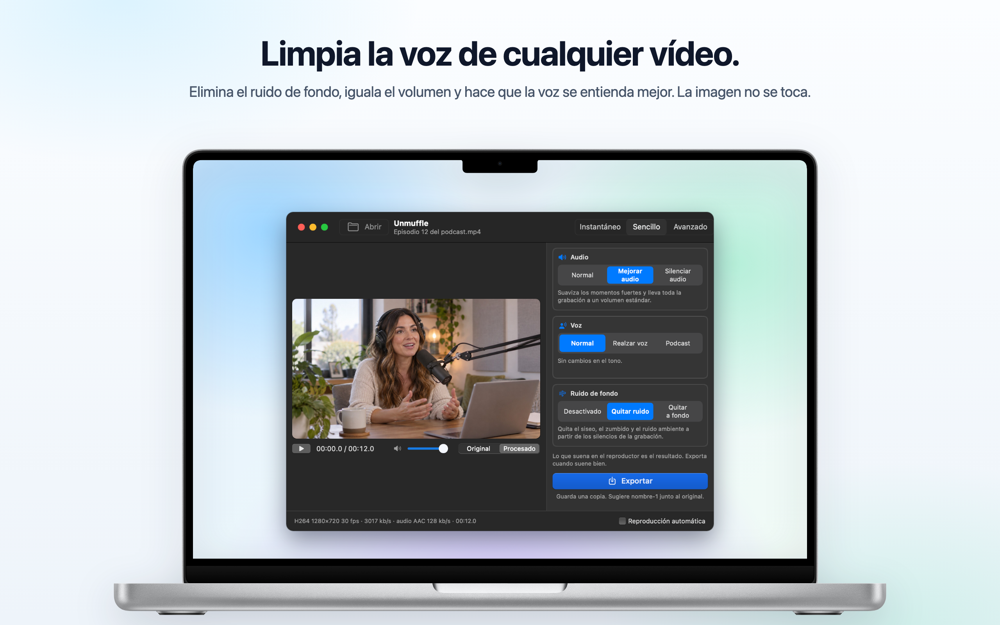
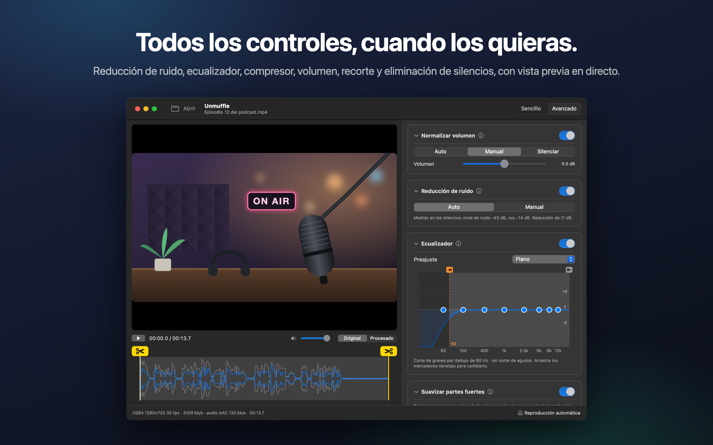
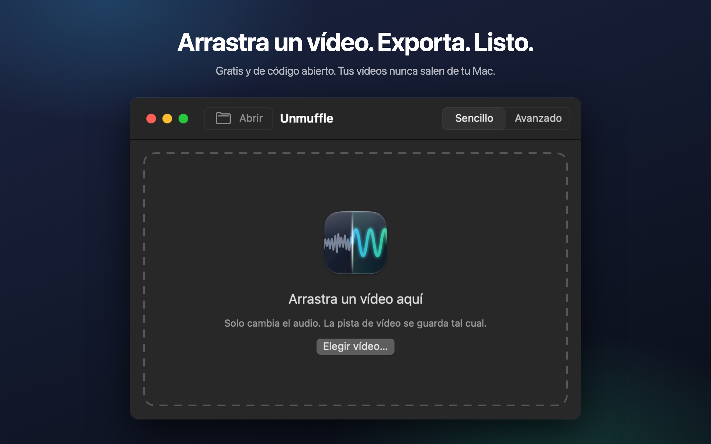

<h1 align="center">Unmuffle</h1>

<b>Limpia la voz de cualquier vídeo.</b> 
Una pequeña app gratuita para Mac que elimina el ruido de fondo, iguala el volumen y hace que la voz se entienda mejor. 
La imagen no se toca.

  
  
  
  
  

  
  &nbsp;
  

Apple Silicon e Intel · macOS 14 o posterior · Notarizada por Apple 
<a href="README.md">English</a> · <b>Español</b> · <a href="README.fr.md">Français</a> · <a href="README.de.md">Deutsch</a> · <a href="README.it.md">Italiano</a> · <a href="README.pt-BR.md">Português</a> · <a href="README.nl.md">Nederlands</a> · <a href="README.pl.md">Polski</a> · <a href="README.ru.md">Русский</a> · <a href="README.tr.md">Türkçe</a> · <a href="README.ja.md">日本語</a> · <a href="README.ko.md">한국어</a> · <a href="README.zh-Hans.md">简体中文</a> · <a href="README.zh-Hant.md">繁體中文</a>

## Qué hace

Arrastra una grabación de pantalla, un vlog o una videollamada. Unmuffle limpia el sonido y guarda una copia.
El original queda como estaba.

<table>
<tr>
<td width="33%" valign="top">
<h3>🔇 Quita el ruido</h3>
Siseo, zumbido y ruido ambiente. El ajuste agresivo también silencia las pausas entre palabras.
</td>
<td width="33%" valign="top">
<h3>🎙️ Voz más clara</h3>
Baja los momentos fuertes, lleva la grabación a un volumen estándar y puede realzar la gama de la voz.
</td>
<td width="33%" valign="top">
<h3>🎬 La imagen no se toca</h3>
La pista de vídeo se copia byte a byte, salvo que cortes algo.
</td>
</tr>
<tr>
<td valign="top">
<h3>✂️ Recorta</h3>
Arrastra los tiradores para recortar, o deja que Unmuffle encuentre los silencios y los quite.
</td>
<td valign="top">
<h3>🔒 Privado</h3>
Todo ocurre en tu Mac. No se sube nada, y no hay cuentas ni seguimiento.
</td>
<td valign="top">
<h3>🔄 Se actualiza solo</h3>
Cuando sale una versión nueva, un aviso te lo dice. Con un clic se instala.
</td>
</tr>
</table>

<table>
<tr>
<td></td>
<td></td>
</tr>
<tr>
<td align="center">El modo Avanzado muestra todos los ajustes</td>
<td align="center">Arrastra un vídeo para empezar</td>
</tr>
</table>

## Instalación

**Mac App Store:** consigue [Unmuffle en el Mac App Store](https://apps.apple.com/app/unmuffle/id6825195286).
El App Store lo mantiene actualizado.

**GitHub:**

1. Descarga [`Unmuffle.zip`](https://github.com/iAlborz/Unmuffle/releases/latest/download/Unmuffle.zip)
   y arrastra `Unmuffle.app` a la carpeta Aplicaciones. Todo lo que necesita viene incluido.
2. Abre la app. Está notarizada por Apple, así que macOS la abre sin ningún aviso.

Desde la versión 1.3, la versión de GitHub se actualiza sola. Cuando sale una versión nueva, aparece un
aviso en la parte de arriba de la ventana. Haz clic en **Actualizar** y Unmuffle la descarga, la instala y
se vuelve a abrir. También puedes elegir **Unmuffle → Buscar actualizaciones…** cuando quieras.

## Cómo se usa

**El modo Instantáneo** es el más rápido. Arrastra uno o varios vídeos a la ventana (o pulsa ⌘O) y cada
uno se limpia con las opciones de la derecha y se guarda junto al original como `nombre-1.mp4`. No hay
nada que confirmar. La versión del Mac App Store pide permiso una vez por carpeta para guardar en ella.

Arrastra un vídeo a la ventana (o pulsa ⌘O). En el modo Sencillo, el predeterminado, el vídeo empieza a
reproducirse con la limpieza aplicada, así que oyes el resultado al instante. Pulsa **Exportar** y
confirma dónde guardarlo. Te propone `nombre-1.mp4` junto al original (luego `nombre-2`, y así
sucesivamente). Desactiva **Reproducción automática**, abajo a la derecha, si prefieres iniciar tú la
reproducción.

**El modo Sencillo** tiene tres opciones que funcionan juntas:

- **Audio:** dejarlo como se grabó, bajar los momentos fuertes y llevarlo a un volumen estándar, o silenciarlo.
- **Voz:** sin cambios, realzar la gama de la voz para que destaque, o un tono de podcast más lleno.
- **Ruido de fondo:** desactivado, quitar el siseo, el zumbido y el ruido ambiente, o quitarlo de forma
  agresiva y silenciar las pausas entre palabras.

Las opciones se mantienen mientras la app está abierta, así que una tanda de grabaciones es arrastrar,
Exportar, arrastrar, Exportar.

<b>Modo Avanzado</b>

- Reducción de ruido, puerta de ruido, corte de graves y agudos, un ecualizador de 8 bandas, un
  compresor, ganancia y normalización del volumen. Cada tarjeta tiene un botón ⓘ que explica sus ajustes.
- **Detectar ruido** mide el nivel del ruido y el de la voz, y pone unos valores razonables.
- Cambia el reproductor entre **Original** y **Procesado**. Procesado reproduce el audio a través de la
  misma cadena de filtros de ffmpeg que usa Exportar, desde el cabezal de reproducción. Cambia un ajuste
  mientras suena y el sonido lo sigue un momento después.
- El ecualizador es un gráfico con ocho puntos. Arrastra un punto hacia arriba o hacia abajo; haz doble
  clic para restablecerlo.
- Recorta arrastrando los tiradores amarillos con tijeras de la forma de onda.
- **Recortar silencios** encuentra las partes en silencio. Los bloques rojos se eliminan. Haz clic en un
  bloque para conservarlo.

<b>Cómo funciona la reducción de ruido</b>

El reductor de ruido es `afftdn` de ffmpeg, un reductor de ruido espectral (FFT). Sigue el perfil del
ruido de forma continua mientras suena el audio. «Detectar ruido» mide los silencios que encuentra en la
línea de tiempo y usa su nivel mediano como nivel de ruido. Después fija la cantidad de reducción a partir
de la diferencia entre el nivel de ruido y el nivel de la voz.

<b>Calidad de vídeo</b>

- Sin cortes, la pista de vídeo se **copia tal cual** (stream copy). Es idéntica byte a byte a la original.
- Recortar o quitar silencios cambia la línea de tiempo, así que hay que volver a codificar el vídeo. El
  codificador de vídeo por hardware del Mac lo vuelve a codificar con el mismo códec y la misma tasa de
  bits que el original. «Recorte sin pérdida» corta en los fotogramas clave sin volver a codificar, así
  que los puntos de corte pueden desviarse unos fotogramas.

## Para desarrolladores

Para compilar Unmuffle desde el código, publicar una versión o contribuir, consulta el
[README en inglés](README.md#build-from-source). Los issues y pull requests son bienvenidos.

## Privacidad

Unmuffle no recopila datos y tus vídeos nunca salen de tu Mac. La versión de GitHub consulta GitHub una
vez al día para ver si hay una versión nueva; la versión del App Store no se conecta a internet. Consulta
la [política de privacidad](PRIVACY.md) (en inglés).

## Licencia

[MIT](LICENSE). Úsalo, modifícalo, haz un fork, distribúyelo.

Unmuffle incluye [FFmpeg](https://ffmpeg.org) 9.0.2, con licencia
[LGPL 2.1 o posterior](https://www.gnu.org/licenses/old-licenses/lgpl-2.1.html). Se compila a partir del
código fuente oficial sin modificar con [`scripts/build-ffmpeg.sh`](scripts/build-ffmpeg.sh), sin
ninguna parte GPL ni no libre activada, y se incluye como bibliotecas separadas dentro de la app. El texto
de la licencia está en la app, en `Contents/Resources/FFmpeg-LICENSE.txt`. FFmpeg es una marca comercial
de Fabrice Bellard.

La versión de GitHub incluye [Sparkle](https://sparkle-project.org) para las actualizaciones, con
[licencia MIT](https://github.com/sparkle-project/Sparkle/blob/2.x/LICENSE). Su texto de licencia está en
la app, en `Contents/Resources/Sparkle-LICENSE.txt`.
