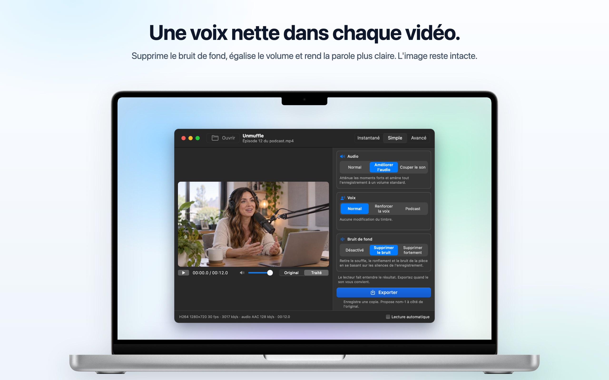
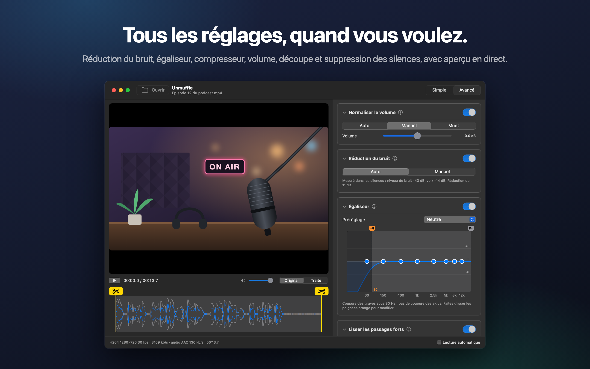
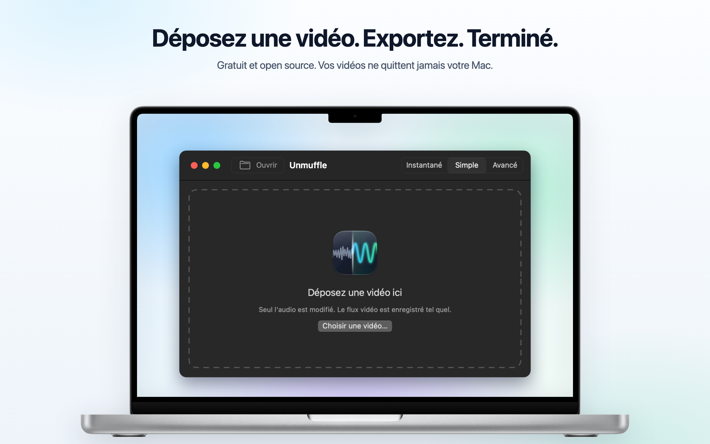

<h1 align="center">Unmuffle</h1>

<b>Nettoyez la voix de n'importe quelle vidéo.</b> 
Une petite app gratuite pour Mac qui supprime le bruit de fond, égalise le volume et rend la parole plus claire. 
L'image reste intacte.

  
  
  
  

  
  &nbsp;
  

Apple Silicon et Intel · macOS 14 ou version ultérieure · Notarisée par Apple

🌐 <b>Français</b> · 13 autres langues

 
🇺🇸&nbsp;<a href="README.md">English</a>&nbsp;&nbsp;·&nbsp; 🇪🇸&nbsp;<a href="README.es.md">Español</a>&nbsp;&nbsp;·&nbsp; 🇩🇪&nbsp;<a href="README.de.md">Deutsch</a>&nbsp;&nbsp;·&nbsp; 🇮🇹&nbsp;<a href="README.it.md">Italiano</a>&nbsp;&nbsp;·&nbsp; 🇧🇷&nbsp;<a href="README.pt-BR.md">Português</a>&nbsp;&nbsp;·&nbsp; 🇳🇱&nbsp;<a href="README.nl.md">Nederlands</a>&nbsp;&nbsp;·&nbsp; 🇵🇱&nbsp;<a href="README.pl.md">Polski</a> 
🇷🇺&nbsp;<a href="README.ru.md">Русский</a>&nbsp;&nbsp;·&nbsp; 🇹🇷&nbsp;<a href="README.tr.md">Türkçe</a>&nbsp;&nbsp;·&nbsp; 🇯🇵&nbsp;<a href="README.ja.md">日本語</a>&nbsp;&nbsp;·&nbsp; 🇰🇷&nbsp;<a href="README.ko.md">한국어</a>&nbsp;&nbsp;·&nbsp; 🇨🇳&nbsp;<a href="README.zh-Hans.md">简体中文</a>&nbsp;&nbsp;·&nbsp; 🇹🇼&nbsp;<a href="README.zh-Hant.md">繁體中文</a>

## Ce que fait Unmuffle

Déposez un enregistrement d'écran, un vlog ou un appel vidéo. Unmuffle nettoie le son et enregistre une copie.
L'original reste tel quel.

<table>
<tr>
<td width="33%" valign="top">
<h3>🔇 Supprime le bruit</h3>
Souffle, ronflement et bruit ambiant. Le réglage le plus fort coupe aussi le son dans les blancs entre les mots.
</td>
<td width="33%" valign="top">
<h3>🎙️ Une voix plus claire</h3>
Atténue les moments forts, amène l'enregistrement à un volume standard et peut faire ressortir les fréquences de la voix.
</td>
<td width="33%" valign="top">
<h3>🎬 L'image reste intacte</h3>
Le flux vidéo est copié octet par octet, sauf si vous coupez quelque chose.
</td>
</tr>
<tr>
<td valign="top">
<h3>✂️ Découpe</h3>
Faites glisser les poignées pour couper, ou laissez Unmuffle trouver les silences et les retirer.
</td>
<td valign="top">
<h3>🔒 Privé</h3>
Tout se passe sur votre Mac. Rien n'est envoyé en ligne, et il n'y a ni compte ni pistage.
</td>
<td valign="top">
<h3>🔄 Mises à jour automatiques</h3>
Quand une nouvelle version sort, un bandeau vous prévient. Un clic suffit pour l'installer.
</td>
</tr>
</table>

<table>
<tr>
<td></td>
<td></td>
</tr>
<tr>
<td align="center">Le mode Avancé affiche tous les réglages</td>
<td align="center">Déposez une vidéo pour commencer</td>
</tr>
</table>

## Installation

**Mac App Store :** téléchargez [Unmuffle sur le Mac App Store](https://apps.apple.com/app/unmuffle/id6825195286).
L'App Store se charge des mises à jour.

**GitHub :**

1. Téléchargez [`Unmuffle.zip`](https://github.com/iAlborz/Unmuffle/releases/latest/download/Unmuffle.zip)
   et faites glisser `Unmuffle.app` dans le dossier Applications. Tout ce qu'il lui faut est déjà inclus.
2. Ouvrez l'app. Elle est notarisée par Apple, donc macOS l'ouvre sans aucun avertissement.

Depuis la version 1.3, la version GitHub se met à jour toute seule. Quand une nouvelle version sort, un
bandeau apparaît en haut de la fenêtre. Cliquez sur **Mettre à jour** : Unmuffle la télécharge, l'installe
et se relance. Vous pouvez aussi choisir **Unmuffle → Rechercher des mises à jour…** à tout moment.

## Utilisation

**Le mode Instantané** est le plus rapide. Déposez une ou plusieurs vidéos sur la fenêtre (ou appuyez sur
⌘O) : chacune est nettoyée avec les choix de droite et enregistrée à côté de l'original sous `nom-1.mp4`.
Il n'y a rien à confirmer. La version Mac App Store demande une fois par dossier l'autorisation d'y
enregistrer.

Déposez une vidéo sur la fenêtre (ou appuyez sur ⌘O). En mode Simple, le mode par défaut, la vidéo se
lance avec le nettoyage appliqué : vous entendez tout de suite le résultat. Cliquez sur **Exporter** et
choisissez où enregistrer. Unmuffle propose `nom-1.mp4` à côté de l'original (puis `nom-2`, etc.).
Décochez **Lecture automatique** en bas à droite si vous préférez lancer la lecture vous-même.

**Le mode Simple** propose trois choix qui se combinent :

- **Audio :** le laisser tel qu'il a été enregistré, atténuer les moments forts et l'amener à un volume
  standard, ou couper le son.
- **Voix :** aucun changement, renforcer les fréquences de la voix pour qu'elle ressorte, ou un ton podcast
  plus ample.
- **Bruit de fond :** désactivé, supprimer le souffle, le ronflement et le bruit ambiant, ou le supprimer
  fortement et couper le son dans les blancs entre les mots.

Les choix restent en place tant que l'app est ouverte. Pour une série d'enregistrements, il suffit donc de
déposer, Exporter, déposer, Exporter.

<b>Mode Avancé</b>

- Réduction du bruit, noise gate, coupure des graves et des aigus, égaliseur 8 bandes, compresseur, gain
  et normalisation du volume. Chaque carte a un bouton ⓘ qui explique ses réglages.
- **Détecter le bruit** mesure le niveau du bruit et celui de la voix, puis choisit des valeurs adaptées.
- Basculez le lecteur entre **Original** et **Traité**. Traité fait passer l'audio dans la même chaîne de
  filtres ffmpeg que l'export, à partir de la tête de lecture. Modifiez un réglage pendant la lecture et
  le son suit un instant plus tard.
- L'égaliseur est un graphique à huit points. Faites glisser un point vers le haut ou vers le bas ;
  double-cliquez dessus pour le réinitialiser.
- Pour couper, faites glisser les poignées jaunes en forme de ciseaux sur la forme d'onde.
- **Couper les silences** repère les passages silencieux. Les blocs rouges sont supprimés. Cliquez sur un
  bloc pour le garder.

<b>Comment fonctionne la réduction du bruit</b>

Le débruiteur est `afftdn` de ffmpeg, un réducteur de bruit spectral (FFT). Il suit le profil du bruit en
continu pendant la lecture. « Détecter le bruit » mesure les silences repérés sur la timeline et prend
leur niveau médian comme niveau de bruit. Il règle ensuite l'intensité de la réduction d'après l'écart
entre le niveau de bruit et celui de la voix.

<b>Qualité vidéo</b>

- Sans coupe, le flux vidéo est **copié tel quel** (stream copy). Il est identique à la source, octet par
  octet.
- Les coupes, y compris celles des silences, modifient la timeline : la vidéo doit donc être réencodée.
  L'encodeur vidéo matériel du Mac la réencode avec le même codec et le même débit que la source.
  « Découpe sans perte », elle, coupe aux images clés sans réencoder, si bien que les points de coupe
  peuvent être décalés de quelques images.

## Pour les développeurs

Pour compiler Unmuffle à partir du code source, publier une version ou contribuer, consultez le
[README en anglais](README.md#build-from-source). Les issues et les pull requests sont les bienvenues.

## Confidentialité

Unmuffle ne collecte aucune donnée, et vos vidéos ne quittent jamais votre Mac. La version GitHub
interroge GitHub environ une fois par jour pour savoir s'il existe une nouvelle version ; la version App
Store n'établit aucune connexion réseau. Consultez la [politique de confidentialité](PRIVACY.md) (en
anglais).

## Licence

[MIT](LICENSE). Utilisez-le, modifiez-le, forkez-le, distribuez-le.

Unmuffle inclut [FFmpeg](https://ffmpeg.org) 9.0.2, sous licence
[LGPL 2.1 ou version ultérieure](https://www.gnu.org/licenses/old-licenses/lgpl-2.1.html). Il est compilé
à partir du code source officiel non modifié par [`scripts/build-ffmpeg.sh`](scripts/build-ffmpeg.sh),
sans aucune partie GPL ou non libre activée, et livré sous forme de bibliothèques séparées dans l'app. Le
texte de la licence se trouve dans l'app, dans `Contents/Resources/FFmpeg-LICENSE.txt`. FFmpeg est une
marque de Fabrice Bellard.

La version GitHub inclut [Sparkle](https://sparkle-project.org) pour les mises à jour, sous
[licence MIT](https://github.com/sparkle-project/Sparkle/blob/2.x/LICENSE). Son texte de licence se
trouve dans l'app, dans `Contents/Resources/Sparkle-LICENSE.txt`.
