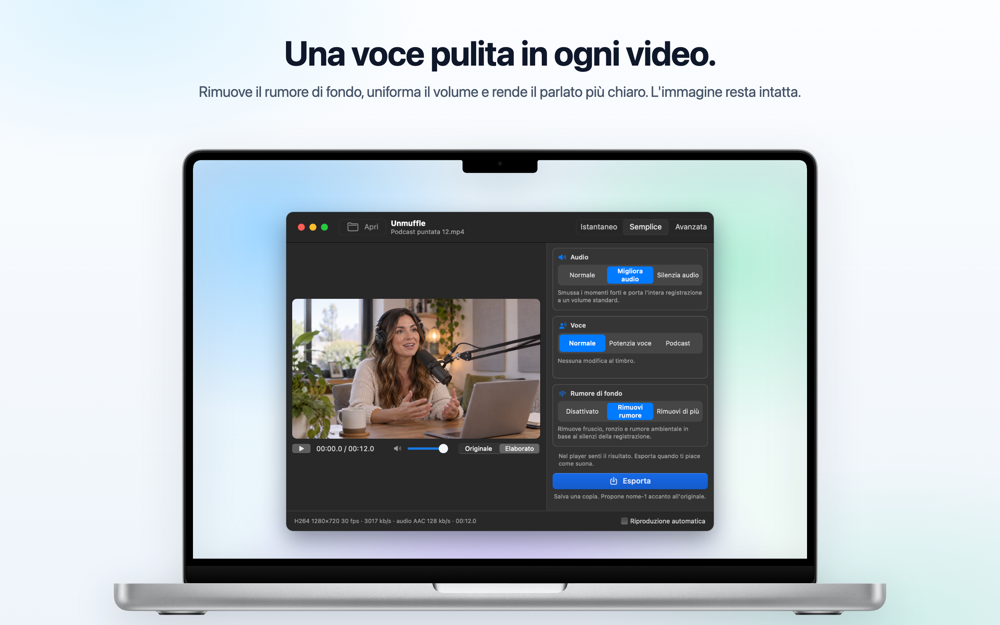
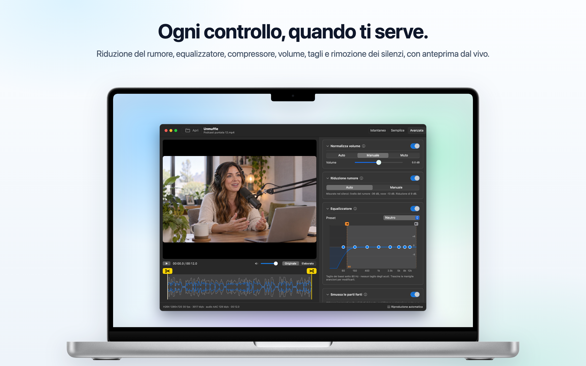
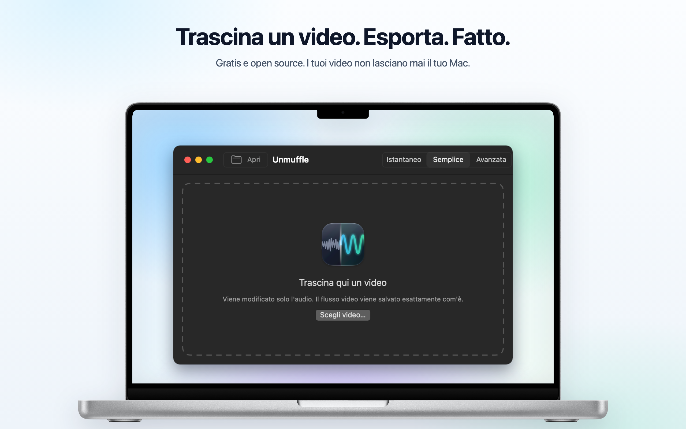

<h1 align="center">Unmuffle</h1>

<b>Pulisci la voce in qualsiasi video.</b> 
Una piccola app gratuita per Mac che rimuove il rumore di fondo, uniforma il volume e rende il parlato più chiaro. 
L'immagine resta intatta.

  
  
  
  

  
  &nbsp;
  

Apple Silicon e Intel · macOS 14 o versioni successive · Notarizzata da Apple

🌐 <b>Italiano</b> · altre 13 lingue

 
🇺🇸&nbsp;<a href="README.md">English</a>&nbsp;&nbsp;·&nbsp; 🇪🇸&nbsp;<a href="README.es.md">Español</a>&nbsp;&nbsp;·&nbsp; 🇫🇷&nbsp;<a href="README.fr.md">Français</a>&nbsp;&nbsp;·&nbsp; 🇩🇪&nbsp;<a href="README.de.md">Deutsch</a>&nbsp;&nbsp;·&nbsp; 🇧🇷&nbsp;<a href="README.pt-BR.md">Português</a>&nbsp;&nbsp;·&nbsp; 🇳🇱&nbsp;<a href="README.nl.md">Nederlands</a>&nbsp;&nbsp;·&nbsp; 🇵🇱&nbsp;<a href="README.pl.md">Polski</a> 
🇷🇺&nbsp;<a href="README.ru.md">Русский</a>&nbsp;&nbsp;·&nbsp; 🇹🇷&nbsp;<a href="README.tr.md">Türkçe</a>&nbsp;&nbsp;·&nbsp; 🇯🇵&nbsp;<a href="README.ja.md">日本語</a>&nbsp;&nbsp;·&nbsp; 🇰🇷&nbsp;<a href="README.ko.md">한국어</a>&nbsp;&nbsp;·&nbsp; 🇨🇳&nbsp;<a href="README.zh-Hans.md">简体中文</a>&nbsp;&nbsp;·&nbsp; 🇹🇼&nbsp;<a href="README.zh-Hant.md">繁體中文</a>

## Cosa fa

Trascina una registrazione dello schermo, un vlog o una videochiamata. Unmuffle ripulisce l'audio e salva una copia.
L'originale resta com'era.

<table>
<tr>
<td width="33%" valign="top">
<h3>🔇 Rimuove il rumore</h3>
Fruscio, ronzio e rumore ambientale. L'impostazione più forte silenzia anche le pause tra le parole.
</td>
<td width="33%" valign="top">
<h3>🎙️ Voce più chiara</h3>
Smussa i momenti forti, porta la registrazione a un volume standard e può esaltare la gamma della voce.
</td>
<td width="33%" valign="top">
<h3>🎬 Immagine intatta</h3>
Il flusso video viene copiato byte per byte, a meno che tu non tagli qualcosa.
</td>
</tr>
<tr>
<td valign="top">
<h3>✂️ Taglia</h3>
Trascina le maniglie per tagliare, oppure lascia che Unmuffle trovi i silenzi e li elimini.
</td>
<td valign="top">
<h3>🔒 Privato</h3>
Tutto avviene sul tuo Mac. Non viene caricato nulla, e non ci sono account né tracciamento.
</td>
<td valign="top">
<h3>🔄 Si aggiorna da sé</h3>
Quando esce una nuova versione, un banner ti avvisa. Basta un clic per installarla.
</td>
</tr>
</table>

<table>
<tr>
<td></td>
<td></td>
</tr>
<tr>
<td align="center">La modalità Avanzata mostra tutte le impostazioni</td>
<td align="center">Trascina un video per iniziare</td>
</tr>
</table>

## Installazione

**Mac App Store:** scarica [Unmuffle dal Mac App Store](https://apps.apple.com/app/unmuffle/id6825195286).
Agli aggiornamenti ci pensa l'App Store.

**GitHub:**

1. Scarica [`Unmuffle.zip`](https://github.com/iAlborz/Unmuffle/releases/latest/download/Unmuffle.zip)
   e trascina `Unmuffle.app` nella cartella Applicazioni. Tutto quello che serve è già incluso.
2. Apri l'app. È notarizzata da Apple, quindi macOS la apre senza alcun avviso.

Dalla versione 1.3, la versione GitHub si aggiorna da sola. Quando esce una nuova versione, in cima alla
finestra compare un banner. Fai clic su **Aggiorna** e Unmuffle la scarica, la installa e si riavvia. Puoi
anche scegliere **Unmuffle → Verifica aggiornamenti…** in qualsiasi momento.

## Come si usa

**Istantaneo** è la modalità più rapida. Trascina uno o più video sulla finestra (o premi ⌘O): ognuno
viene ripulito con le scelte a destra e salvato accanto all'originale come `nome-1.mp4`. Non c'è niente
da confermare. La versione del Mac App Store chiede una sola volta per cartella il permesso di salvarci.

Trascina un video sulla finestra (o premi ⌘O). In modalità Semplice, quella predefinita, il video parte
con la pulizia già applicata, così senti subito il risultato. Premi **Esporta** e conferma dove salvarlo.
Unmuffle propone `nome-1.mp4` accanto all'originale (poi `nome-2` e così via). Disattiva
**Riproduzione automatica** in basso a destra se preferisci avviare tu la riproduzione.

**La modalità Semplice** ha tre scelte che lavorano insieme:

- **Audio:** lasciarlo com'è stato registrato, smussare i momenti forti e portarlo a un volume standard,
  oppure silenziarlo.
- **Voce:** nessuna modifica, esaltare la gamma del parlato perché la voce emerga, oppure un tono da
  podcast più pieno.
- **Rumore di fondo:** disattivato, rimuovere fruscio, ronzio e rumore ambientale, oppure rimuoverlo con
  più decisione e silenziare le pause tra le parole.

Le scelte restano impostate finché l'app è aperta, quindi una serie di registrazioni diventa: trascina,
Esporta, trascina, Esporta.

<b>Modalità Avanzata</b>

- Riduzione del rumore, noise gate, taglio dei bassi e degli acuti, un equalizzatore a 8 bande, un
  compressore, guadagno e normalizzazione del volume. Ogni scheda ha un pulsante ⓘ che ne spiega le
  impostazioni.
- **Rileva rumore** misura il livello del rumore e quello della voce e imposta valori sensati.
- Nel player passa da **Originale** a **Elaborato** e viceversa. Elaborato fa passare l'audio nella
  stessa catena di filtri ffmpeg usata da Esporta, a partire dalla testina di riproduzione. Cambia
  un'impostazione durante la riproduzione e il suono si adegua un attimo dopo.
- L'equalizzatore è un grafico con otto punti. Trascina un punto in alto o in basso; fai doppio clic per
  reimpostarlo.
- Per tagliare, trascina le maniglie gialle con le forbici sulla forma d'onda.
- **Taglia i silenzi** trova le parti silenziose. I blocchi rossi vengono rimossi. Fai clic su un blocco
  per mantenerlo.

<b>Come funziona la riduzione del rumore</b>

Il riduttore di rumore è `afftdn` di ffmpeg, un riduttore di rumore spettrale (FFT). Segue il profilo del
rumore in modo continuo mentre l'audio scorre. «Rileva rumore» misura i silenzi trovati sulla timeline e
usa il loro livello mediano come livello del rumore. Poi imposta l'intensità della riduzione in base alla
differenza tra il livello del rumore e quello della voce.

<b>Qualità video</b>

- Senza tagli, il flusso video viene **copiato così com'è** (stream copy). È identico all'originale byte
  per byte.
- I tagli, compresi quelli dei silenzi, cambiano la timeline, quindi il video va ricodificato. Il
  codificatore video hardware del Mac lo ricodifica con lo stesso codec e lo stesso bitrate
  dell'originale. «Taglio senza perdita», invece, taglia sui fotogrammi chiave senza ricodificare, quindi
  i punti di taglio possono spostarsi di qualche fotogramma.

## Per sviluppatori

Per compilare Unmuffle dal codice sorgente, pubblicare una versione o contribuire, consulta il
[README in inglese](README.md#build-from-source). Issue e pull request sono benvenute.

## Privacy

Unmuffle non raccoglie dati e i tuoi video non lasciano mai il tuo Mac. La versione GitHub controlla su
GitHub circa una volta al giorno se c'è una nuova versione; la versione App Store non si connette alla
rete. Consulta l'[informativa sulla privacy](PRIVACY.md) (in inglese).

## Licenza

[MIT](LICENSE). Usalo, modificalo, fanne un fork, distribuiscilo.

Unmuffle include [FFmpeg](https://ffmpeg.org) 9.0.2, con licenza
[LGPL 2.1 o successiva](https://www.gnu.org/licenses/old-licenses/lgpl-2.1.html). Viene compilato dal
codice sorgente ufficiale non modificato tramite [`scripts/build-ffmpeg.sh`](scripts/build-ffmpeg.sh),
senza parti GPL o non libere attivate, ed è incluso nell'app come librerie separate. Il testo della
licenza si trova nell'app, in `Contents/Resources/FFmpeg-LICENSE.txt`. FFmpeg è un marchio di Fabrice
Bellard.

La versione GitHub include [Sparkle](https://sparkle-project.org) per gli aggiornamenti, con
[licenza MIT](https://github.com/sparkle-project/Sparkle/blob/2.x/LICENSE). Il testo della sua licenza si
trova nell'app, in `Contents/Resources/Sparkle-LICENSE.txt`.
