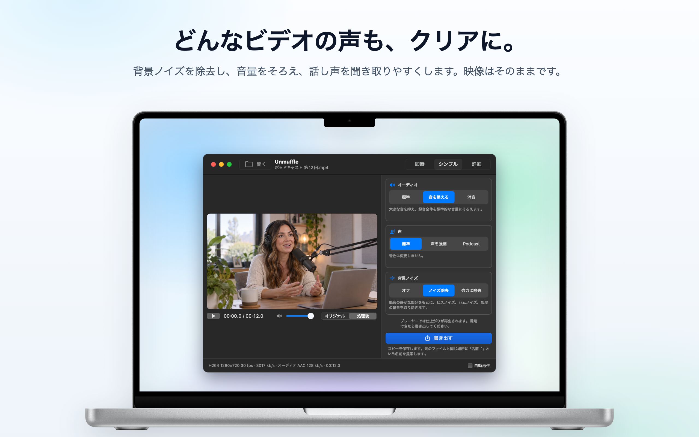
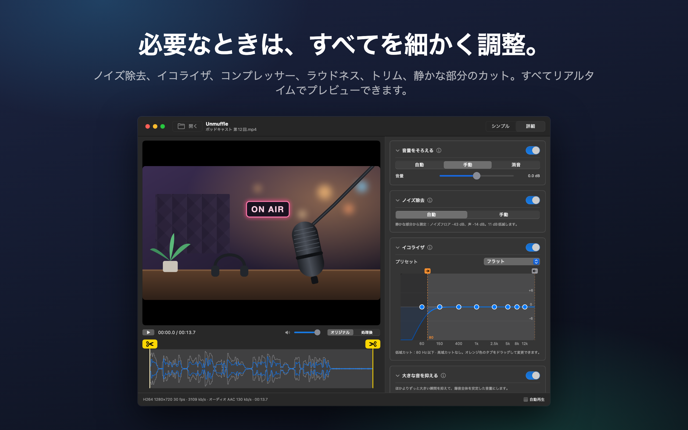
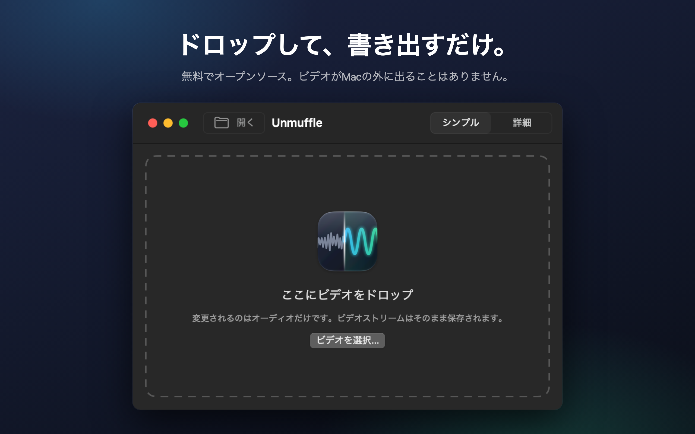

<h1 align="center">Unmuffle</h1>

<b>どんなビデオの声も、クリアに。</b> 
背景ノイズを除去し、音量をそろえ、話し声を聞き取りやすくする、小さな無料のMacアプリです。 
映像には手を加えません。

  
  
  
  

  
  &nbsp;
  

Apple SiliconとIntelに対応 · macOS 14以降 · Appleによる公証済み

🌐 <b>日本語</b> · ほか13言語

 
🇺🇸&nbsp;<a href="README.md">English</a>&nbsp;&nbsp;·&nbsp; 🇪🇸&nbsp;<a href="README.es.md">Español</a>&nbsp;&nbsp;·&nbsp; 🇫🇷&nbsp;<a href="README.fr.md">Français</a>&nbsp;&nbsp;·&nbsp; 🇩🇪&nbsp;<a href="README.de.md">Deutsch</a>&nbsp;&nbsp;·&nbsp; 🇮🇹&nbsp;<a href="README.it.md">Italiano</a>&nbsp;&nbsp;·&nbsp; 🇧🇷&nbsp;<a href="README.pt-BR.md">Português</a>&nbsp;&nbsp;·&nbsp; 🇳🇱&nbsp;<a href="README.nl.md">Nederlands</a> 
🇵🇱&nbsp;<a href="README.pl.md">Polski</a>&nbsp;&nbsp;·&nbsp; 🇷🇺&nbsp;<a href="README.ru.md">Русский</a>&nbsp;&nbsp;·&nbsp; 🇹🇷&nbsp;<a href="README.tr.md">Türkçe</a>&nbsp;&nbsp;·&nbsp; 🇰🇷&nbsp;<a href="README.ko.md">한국어</a>&nbsp;&nbsp;·&nbsp; 🇨🇳&nbsp;<a href="README.zh-Hans.md">简体中文</a>&nbsp;&nbsp;·&nbsp; 🇹🇼&nbsp;<a href="README.zh-Hant.md">繁體中文</a>

## できること

画面収録、Vlog、ビデオ通話などをドロップするだけ。Unmuffleが音声をクリーンアップして、コピーを保存します。元のファイルはそのまま残ります。

<table>
<tr>
<td width="33%" valign="top">
<h3>🔇 ノイズを除去</h3>
ヒスノイズ、ハムノイズ、部屋の雑音を取り除きます。強力な設定では、言葉と言葉の間も無音にします。
</td>
<td width="33%" valign="top">
<h3>🎙️ クリアな声</h3>
大きな音を抑え、録音を標準的な音量にそろえます。話し声の帯域を強調することもできます。
</td>
<td width="33%" valign="top">
<h3>🎬 映像はそのまま</h3>
何もカットしなければ、ビデオストリームは1バイトも変えずにコピーされます。
</td>
</tr>
<tr>
<td valign="top">
<h3>✂️ トリム</h3>
ハンドルをドラッグしてトリムできます。静かな部分をUnmuffleに見つけてもらい、カットすることもできます。
</td>
<td valign="top">
<h3>🔒 プライベート</h3>
すべての処理はMac上で行われます。何もアップロードされず、アカウントもトラッキングもありません。
</td>
<td valign="top">
<h3>🔄 自動でアップデート</h3>
新しいバージョンが出ると、バナーでお知らせします。クリック1回でインストールできます。
</td>
</tr>
</table>

<table>
<tr>
<td></td>
<td></td>
</tr>
<tr>
<td align="center">詳細モードではすべての設定が表示されます</td>
<td align="center">ビデオをドロップして始めましょう</td>
</tr>
</table>

## インストール

**Mac App Store**：[Mac App StoreでUnmuffleを入手](https://apps.apple.com/app/unmuffle/id6825195286)できます。アップデートはApp Storeが行います。

**GitHub**：

1. [`Unmuffle.zip`](https://github.com/iAlborz/Unmuffle/releases/latest/download/Unmuffle.zip)をダウンロードし、`Unmuffle.app`を「アプリケーション」フォルダにドラッグします。必要なものはすべてアプリに含まれています。
2. アプリを開きます。Appleによる公証済みなので、macOSは警告を出さずに開きます。

バージョン1.3以降、GitHub版は自動でアップデートされます。新しいバージョンが出ると、ウインドウの上部にバナーが表示されます。**アップデート**をクリックすると、Unmuffleがダウンロードとインストールを行い、再起動します。「**Unmuffle → アップデートを確認…**」を選べば、いつでも手動で確認できます。

## 使いかた

いちばん手軽なのは**即時モード**です。ビデオを1本または複数、ウインドウにドロップする（または⌘Oを押す）と、右側の設定でそれぞれクリーンアップされ、元のファイルの隣に`名前-1.mp4`として保存されます。確認の操作はいりません。Mac App Store版では、フォルダごとに1回だけ、そこへの保存の許可を求められます。

ビデオをウインドウにドロップします（または⌘Oを押します）。デフォルトのシンプルモードでは、補正を適用した状態でビデオの再生が始まるので、仕上がりをすぐに確認できます。**書き出す**を押して、保存場所を確認します。元のファイルの隣に`名前-1.mp4`という名前が提案されます（以降は`名前-2`、と続きます）。再生を自分で始めたい場合は、右下の**自動再生**をオフにしてください。

**シンプルモード**には、組み合わせて使う3つの選択肢があります：

- **オーディオ**：録音したまま、大きな音を抑えて標準的な音量にそろえる、または消音。
- **声**：変更なし、話し声の帯域を強調して声を際立たせる、または厚みのあるポッドキャスト風のトーン。
- **背景ノイズ**：オフ、ヒスノイズ・ハムノイズ・部屋の雑音を除去、または強力に除去して言葉と言葉の間も無音にする。

選んだ設定はアプリを開いている間は保持されるので、たくさんの録音も「ドロップ、書き出し、ドロップ、書き出し」の繰り返しで片づきます。

<b>詳細モード</b>

- ノイズ除去、ノイズゲート、低域カットと高域カット、8バンドイコライザ、コンプレッサー、ゲイン、ラウドネスノーマライズ。各カードには、その設定を説明するⓘボタンがあります。
- **ノイズを検出**は、ノイズフロアと話し声のレベルを測定して、適切な値を設定します。
- プレーヤーは**オリジナル**と**処理後**を切り替えられます。「処理後」では、書き出しと同じffmpegのフィルタチェーンにオーディオを通して、再生ヘッドの位置から再生します。再生中に設定を変えると、少し遅れて音に反映されます。
- イコライザは8つのポイントを持つグラフです。ポイントを上下にドラッグし、ダブルクリックでリセットします。
- 波形上にある黄色いはさみのハンドルをドラッグしてトリムします。
- **静かな部分をカット**は、無音の部分を見つけます。赤いブロックが削除される部分です。ブロックをクリックすると、その部分を残せます。

<b>ノイズ除去のしくみ</b>

ノイズ除去にはffmpegの`afftdn`を使っています。これはスペクトル（FFT）方式のノイズリダクションで、オーディオの再生中もノイズのプロファイルを常に追跡します。「ノイズを検出」は、タイムライン上で見つかった静かな部分を測定し、そのレベルの中央値をノイズフロアとします。そのうえで、ノイズフロアと声のレベルの差から低減量を決めます。

<b>画質について</b>

- カットしなければ、ビデオは**ストリームコピー**されます。元のファイルと1バイト単位で同一です。
- トリムや無音部分のカットをするとタイムラインが変わるため、ビデオの再エンコードが必要になります。その場合はMacのハードウェアビデオエンコーダが、元と同じコーデックとビットレートで再エンコードします。「無劣化トリム」を使うと、再エンコードせずにキーフレームでカットします。そのぶん、カット位置が数フレームずれることがあります。

## 開発者の方へ

ソースからのビルド、新しいバージョンのリリース、コントリビュートの方法については、[英語版のREADME](README.md#build-from-source)をご覧ください。IssueやPull Requestも歓迎します。

## プライバシー

Unmuffleはデータを一切収集せず、ビデオがMacの外に出ることもありません。GitHub版は1日に1回ほど、新しいバージョンがないかGitHubを確認します。App Store版はネットワークに一切接続しません。詳しくは[プライバシーポリシー](PRIVACY.md)（英語）をご覧ください。

## ライセンス

[MIT](LICENSE)。自由に使って、改変して、フォークして、配布してください。

Unmuffleには[FFmpeg](https://ffmpeg.org) 9.0.2が含まれています（ライセンスは[LGPL 2.1以降](https://www.gnu.org/licenses/old-licenses/lgpl-2.1.html)）。FFmpegは[`scripts/build-ffmpeg.sh`](scripts/build-ffmpeg.sh)によって改変のない公式ソースからビルドされ、GPLや非フリーの部分は一切有効にしていません。アプリ内には独立したライブラリとして同梱されています。ライセンス文はアプリ内の`Contents/Resources/FFmpeg-LICENSE.txt`にあります。FFmpegはFabrice Bellardの商標です。

GitHub版には、アップデートのために[Sparkle](https://sparkle-project.org)が含まれています（[MITライセンス](https://github.com/sparkle-project/Sparkle/blob/2.x/LICENSE)）。ライセンス文はアプリ内の`Contents/Resources/Sparkle-LICENSE.txt`にあります。
