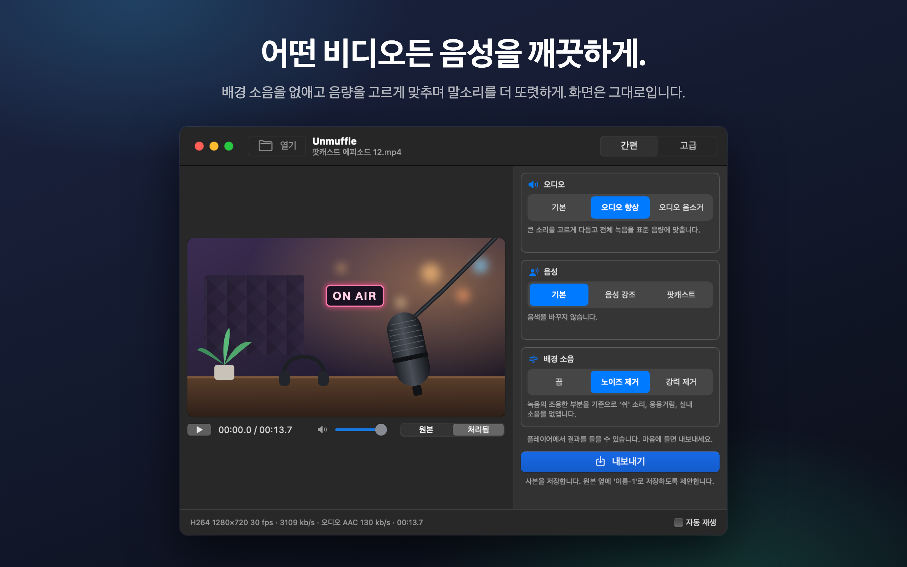
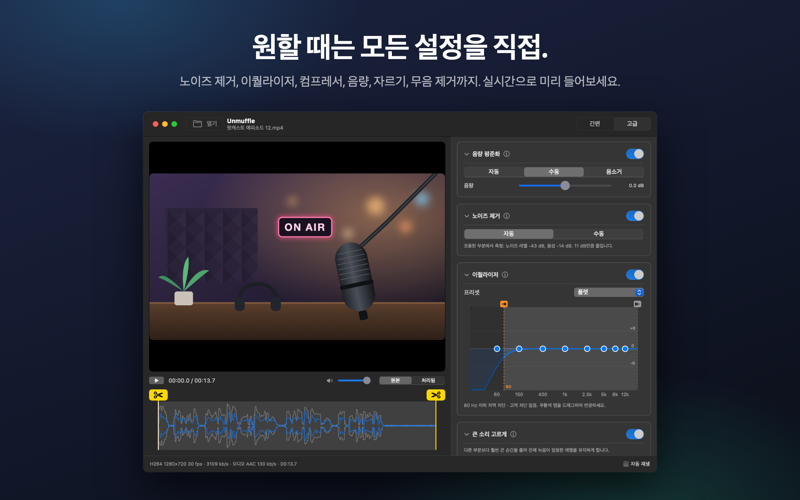
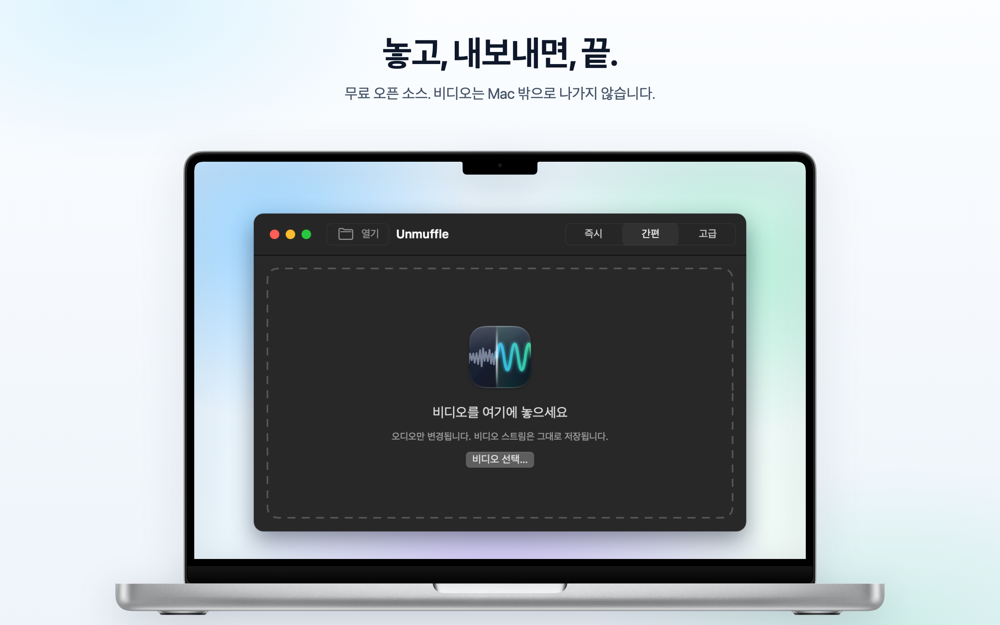

<h1 align="center">Unmuffle</h1>

<b>어떤 비디오든 음성을 깨끗하게.</b> 
배경 소음을 없애고 음량을 고르게 맞추며 말소리를 더 또렷하게 만드는 작은 무료 Mac 앱입니다. 
화면은 그대로입니다.

  
  
  
  

  
  &nbsp;
  

Apple Silicon 및 Intel · macOS 14 이상 · Apple 공증 완료

🌐 <b>한국어</b> · 외 13개 언어

 
🇺🇸&nbsp;<a href="README.md">English</a>&nbsp;&nbsp;·&nbsp; 🇪🇸&nbsp;<a href="README.es.md">Español</a>&nbsp;&nbsp;·&nbsp; 🇫🇷&nbsp;<a href="README.fr.md">Français</a>&nbsp;&nbsp;·&nbsp; 🇩🇪&nbsp;<a href="README.de.md">Deutsch</a>&nbsp;&nbsp;·&nbsp; 🇮🇹&nbsp;<a href="README.it.md">Italiano</a>&nbsp;&nbsp;·&nbsp; 🇧🇷&nbsp;<a href="README.pt-BR.md">Português</a>&nbsp;&nbsp;·&nbsp; 🇳🇱&nbsp;<a href="README.nl.md">Nederlands</a> 
🇵🇱&nbsp;<a href="README.pl.md">Polski</a>&nbsp;&nbsp;·&nbsp; 🇷🇺&nbsp;<a href="README.ru.md">Русский</a>&nbsp;&nbsp;·&nbsp; 🇹🇷&nbsp;<a href="README.tr.md">Türkçe</a>&nbsp;&nbsp;·&nbsp; 🇯🇵&nbsp;<a href="README.ja.md">日本語</a>&nbsp;&nbsp;·&nbsp; 🇨🇳&nbsp;<a href="README.zh-Hans.md">简体中文</a>&nbsp;&nbsp;·&nbsp; 🇹🇼&nbsp;<a href="README.zh-Hant.md">繁體中文</a>

## 주요 기능

화면 녹화, 브이로그, 영상 통화를 끌어다 놓으세요. 소리를 깨끗하게 다듬어 사본으로 저장합니다.
원본은 그대로 남습니다.

<table>
<tr>
<td width="33%" valign="top">
<h3>🔇 소음 제거</h3>
'쉬' 소리, 웅웅거림, 실내 소음을 없앱니다. 강한 설정에서는 단어 사이의 쉼도 음소거합니다.
</td>
<td width="33%" valign="top">
<h3>🎙️ 더 또렷한 음성</h3>
큰 소리를 고르게 다듬고, 녹음을 표준 음량에 맞추며, 말소리 대역을 강조할 수도 있습니다.
</td>
<td width="33%" valign="top">
<h3>🎬 화면은 그대로</h3>
잘라낸 부분이 없으면 비디오 스트림을 바이트 하나까지 그대로 복사합니다.
</td>
</tr>
<tr>
<td valign="top">
<h3>✂️ 자르기</h3>
핸들을 드래그해 자르거나, Unmuffle에 맡겨 조용한 부분을 찾아 잘라낼 수 있습니다.
</td>
<td valign="top">
<h3>🔒 개인정보 보호</h3>
모든 작업이 Mac에서 이루어집니다. 아무것도 업로드하지 않으며, 계정도 추적도 없습니다.
</td>
<td valign="top">
<h3>🔄 자동 업데이트</h3>
새 버전이 나오면 배너로 알려 줍니다. 클릭 한 번이면 설치됩니다.
</td>
</tr>
</table>

<table>
<tr>
<td></td>
<td></td>
</tr>
<tr>
<td align="center">고급 모드에서는 모든 설정이 보입니다</td>
<td align="center">비디오를 놓으면 시작됩니다</td>
</tr>
</table>

## 설치

**Mac App Store:** [Mac App Store의 Unmuffle 페이지](https://apps.apple.com/app/unmuffle/id6825195286)에서 받으세요.
업데이트는 App Store가 알아서 해 줍니다.

**GitHub:**

1. [`Unmuffle.zip`](https://github.com/iAlborz/Unmuffle/releases/latest/download/Unmuffle.zip) 파일을
   다운로드한 뒤 `Unmuffle.app`을 응용 프로그램 폴더로 드래그하세요. 필요한 것은 모두 앱 안에 들어 있습니다.
2. 앱을 여세요. Apple의 공증을 받은 앱이라 macOS가 경고 없이 엽니다.

1.3부터 GitHub 버전은 자동으로 업데이트됩니다. 새 버전이 나오면 창 위쪽에 배너가 나타납니다.
**업데이트**를 클릭하면 새 버전을 다운로드해 설치한 뒤 앱이 다시 실행됩니다. 언제든
메뉴에서 **Unmuffle → 업데이트 확인…** 항목을 선택해 직접 확인할 수도 있습니다.

## 사용 방법

**즉시 모드**가 가장 빠릅니다. 창에 비디오를 하나 이상 놓으면(또는 ⌘O를 누르면) 각 비디오가 오른쪽
옵션대로 정리되어 원본 옆에 `이름-1.mp4`로 저장됩니다. 따로 확인할 것은 없습니다. Mac App Store
버전은 폴더마다 한 번씩 저장 권한을 요청합니다.

창에 비디오를 놓으세요(또는 ⌘O를 누르세요). 기본 모드인 간편 모드에서는 보정이 적용된 상태로 비디오가
재생되므로 결과를 바로 들을 수 있습니다. **내보내기**를 누르고 저장할 위치를 확인하세요. 원본 옆에
`이름-1.mp4`라는 이름을 제안합니다(그다음은 `이름-2` 등). 재생을 직접 시작하고 싶다면 오른쪽 아래의
**자동 재생**을 끄세요.

**간편 모드**에는 함께 작동하는 세 가지 옵션이 있습니다.

- **오디오:** 녹음된 그대로 두기, 큰 소리를 고르게 다듬고 표준 음량에 맞추기, 또는 음소거.
- **음성:** 변경 없음, 말소리 대역을 강조해 음성이 잘 들리게 하기, 또는 더 풍성한 팟캐스트 톤.
- **배경 소음:** 끔, '쉬' 소리·웅웅거림·실내 소음 제거, 또는 강력하게 제거하고 단어 사이의 쉼까지
  음소거.

앱이 열려 있는 동안 선택한 옵션이 유지되므로, 여러 녹음을 처리할 때는 놓고 내보내기, 놓고 내보내기를
반복하면 됩니다.

<b>고급 모드</b>

- 노이즈 제거, 노이즈 게이트, 저역·고역 차단, 8밴드 이퀄라이저, 컴프레서, 게인, 음량 평준화를 제공합니다.
  각 카드에는 설정을 설명하는 ⓘ 버튼이 있습니다.
- **노이즈 감지**는 노이즈 레벨과 음성 레벨을 측정해 적절한 값을 설정합니다.
- 플레이어를 **원본**과 **처리됨** 사이에서 전환하세요. 처리됨을 선택하면 재생 헤드 위치부터 오디오를
  내보내기와 똑같은 ffmpeg 필터 체인에 통과시켜 재생합니다. 재생 중에 설정을 바꾸면 잠시 후 소리에
  반영됩니다.
- 이퀄라이저는 점 8개가 있는 그래프입니다. 점을 위아래로 드래그하고, 더블 클릭하면 초기화됩니다.
- 파형 위의 노란색 가위 핸들을 드래그해 자르세요.
- **조용한 부분 잘라내기**는 무음 구간을 찾습니다. 빨간색 블록은 제거됩니다. 블록을 클릭하면 그 부분은
  유지됩니다.

<b>노이즈 제거 방식</b>

노이즈 제거에는 ffmpeg의 스펙트럼(FFT) 노이즈 제거 필터인 `afftdn`을 사용합니다. 이 필터는 오디오가
재생되는 동안 노이즈 프로필을 계속 추적합니다. '노이즈 감지'는 타임라인에서 찾은 조용한 부분을 측정해
그 중앙값 레벨을 노이즈 레벨로 삼습니다. 그런 다음 노이즈 레벨과 음성 레벨의 차이를 보고 얼마나 줄일지
정합니다.

<b>비디오 화질</b>

- 잘라낸 부분이 없으면 비디오 스트림을 **그대로 복사**(stream copy)합니다. 원본과 바이트 단위까지 똑같습니다.
- 다듬기나 무음 잘라내기를 하면 타임라인이 바뀌므로 비디오를 재인코딩해야 합니다. Mac의 하드웨어
  비디오 인코더가 원본과 같은 코덱과 비트레이트로 재인코딩합니다. 반면 '무손실 자르기'는 재인코딩
  없이 키프레임에서 자르기 때문에 자른 지점이 몇 프레임 어긋날 수 있습니다.

## 개발자 안내

소스 코드로 직접 빌드하거나, 새 버전을 배포하거나, 기여하려면
[영문 README](README.md#build-from-source)를 참고하세요. 이슈와 풀 리퀘스트는 언제나 환영합니다.

## 개인정보 보호

Unmuffle는 어떤 데이터도 수집하지 않으며, 비디오는 Mac 밖으로 나가지 않습니다. GitHub 버전은 하루에
한 번 정도 GitHub에서 새 버전이 있는지 확인하고, App Store 버전은 네트워크에 전혀 연결하지 않습니다.
자세한 내용은 [개인정보 처리방침](PRIVACY.md)(영문)을 참고하세요.

## 라이선스

[MIT](LICENSE). 자유롭게 사용하고, 수정하고, 포크하고, 배포하세요.

Unmuffle에는 [LGPL 2.1 이상](https://www.gnu.org/licenses/old-licenses/lgpl-2.1.html) 라이선스가 적용된
[FFmpeg](https://ffmpeg.org) 9.0.2가 들어 있습니다. 수정하지 않은 공식 소스 코드를
[`scripts/build-ffmpeg.sh`](scripts/build-ffmpeg.sh)로 빌드하며, GPL이나 비자유 구성 요소는 켜지
않습니다. 앱 안에 별도의 라이브러리로 들어 있으며, 라이선스 전문은 앱의
`Contents/Resources/FFmpeg-LICENSE.txt`에 있습니다. FFmpeg 상표는 Fabrice Bellard의 소유입니다.

GitHub 버전에는 업데이트를 위한 [Sparkle](https://sparkle-project.org)도 들어 있으며,
[MIT 라이선스](https://github.com/sparkle-project/Sparkle/blob/2.x/LICENSE)를 따릅니다. 라이선스 전문은
앱의 `Contents/Resources/Sparkle-LICENSE.txt`에 있습니다.
