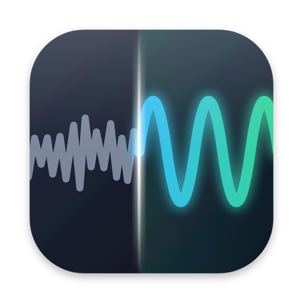
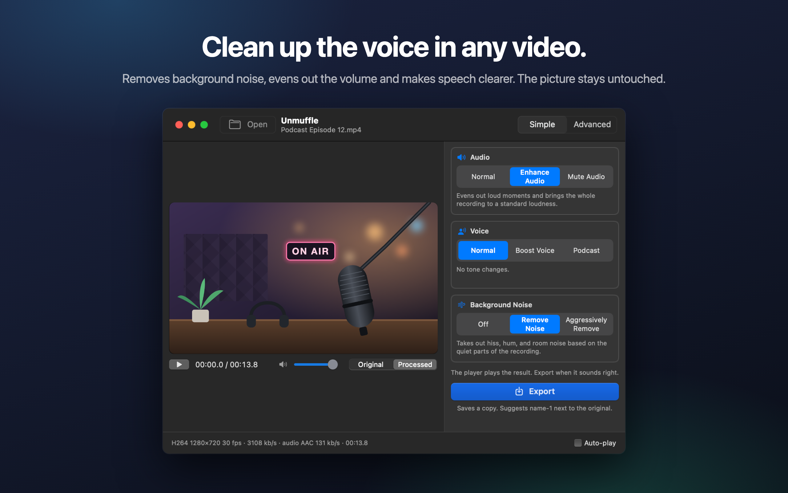

<p align="center"></p>

<h1 align="center">Unmuffle</h1>

<p align="center">A small, free macOS app that cleans up the voice in a video without touching the picture.</p>

<p align="center"></p>

Drop in a screen recording, a vlog or a video call. Unmuffle removes the background noise, evens out
the volume and makes the voice clearer. Then it saves a copy, and the original stays as it was. The
video stream is copied byte for byte unless you cut something.

## Download

1. Download `Unmuffle.zip` from the [latest release](https://github.com/iAlborz/Unmuffle/releases/latest)
   and drag `Unmuffle.app` to your Applications folder. It runs on Apple Silicon and Intel Macs with
   macOS 14 or later. Everything it needs is built in.
2. Open the app. Unmuffle is not notarized by Apple, so the first time macOS blocks it. Click
   **Done**, then open **System Settings → Privacy & Security**, scroll down, and click
   **Open Anyway** next to Unmuffle.

   If macOS says the app is damaged, remove the download flag in Terminal and open it again:

   ```bash
   xattr -dr com.apple.quarantine /Applications/Unmuffle.app
   ```

## How to use it

Drop a video on the window (or press ⌘O). In Simple mode, the default, the video starts playing with
the cleanup applied, so you hear the result right away. Press **Export** and confirm where to save.
It suggests `name-1.mp4` next to the original (then `name-2`, and so on). Turn off **Auto-play** at the bottom right if you'd rather
start playback yourself.

**Simple mode** has three choices that work together:

- **Audio:** leave it as recorded, even out loud moments and bring it to a standard loudness, or mute it.
- **Voice:** no change, boost the speech range so the voice cuts through, or a fuller podcast tone.
- **Background Noise:** off, remove hiss, hum and room noise, or remove it aggressively and mute the
  gaps between words.

The choices stay set while the app is open, so a batch of recordings is drop, Export, drop, Export.

**Advanced mode** shows every setting:

- Noise reduction, noise gate, rumble and hiss cut, an 8-band EQ, a compressor, gain and loudness
  normalization. Each card has an ⓘ button that explains its settings.
- **Detect Noise** measures the noise floor and speech level and sets sensible values.
- Switch the player between **Original** and **Processed**. Processed streams the audio through the
  same ffmpeg filter chain that Export uses, starting from the playhead. Change a setting while it
  plays and the sound follows a moment later.
- The EQ is a graph with eight points. Drag a point up or down; double-click to reset it.
- Trim by dragging the yellow scissors handles on the waveform.
- **Trim Quiet Parts** finds silent parts. Red blocks are removed. Click a block to keep it.

## Noise reduction

The denoiser is ffmpeg's `afftdn`, a spectral (FFT) noise reducer. It tracks the noise profile
continuously while the audio plays. "Detect Noise" measures the quiet parts found on the timeline
and uses their median level as the noise floor, then sets the reduction amount from the gap between
the noise floor and the voice level.

## Video quality

- With no cuts, the video stream is **stream-copied**. It is byte for byte identical to the source.
- Trim or silence cuts change the timeline, so the video must be re-encoded. The Mac's hardware
  video encoder re-encodes it with the same codec and bitrate as the source. "Lossless trim" instead cuts at keyframes without
  re-encoding, so the cut points may be off by a few frames.

## Build from source

You need macOS 14 or later and Xcode or the Xcode Command Line Tools.

```bash
./build.sh
open build/Unmuffle.app
```

The first build also compiles the bundled ffmpeg from source with `scripts/build-ffmpeg.sh`, which
takes about 10 minutes. `./build.sh --universal` builds for both Apple Silicon and Intel.

`Unmuffle.xcodeproj` builds the same app in Xcode and is used for Mac App Store releases.
`swift run` also works for quick development; it uses ffmpeg from Homebrew (`brew install ffmpeg`).

## Contributing

Issues and pull requests are welcome.

## Privacy

Unmuffle collects no data and makes no network connections. See the [privacy policy](PRIVACY.md).

## License

[MIT](LICENSE). Use it, change it, fork it, ship it.

Unmuffle includes [FFmpeg](https://ffmpeg.org) 9.0.2, licensed under the
[LGPL 2.1 or later](https://www.gnu.org/licenses/old-licenses/lgpl-2.1.html). It is built from the
unmodified official source by [`scripts/build-ffmpeg.sh`](scripts/build-ffmpeg.sh), with no GPL or
non-free parts enabled, and ships as separate libraries inside the app. The license text is in the
app at `Contents/Resources/FFmpeg-LICENSE.txt`. FFmpeg is a trademark of Fabrice Bellard.
