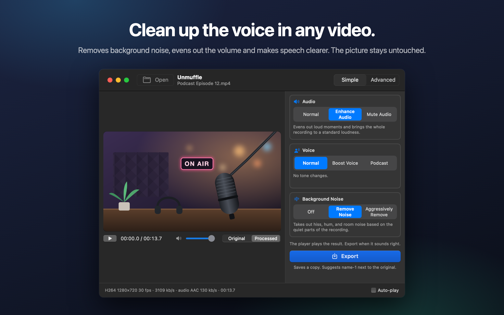
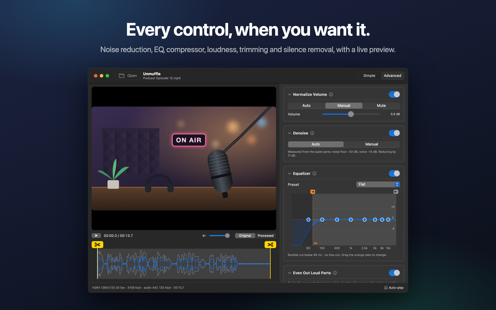
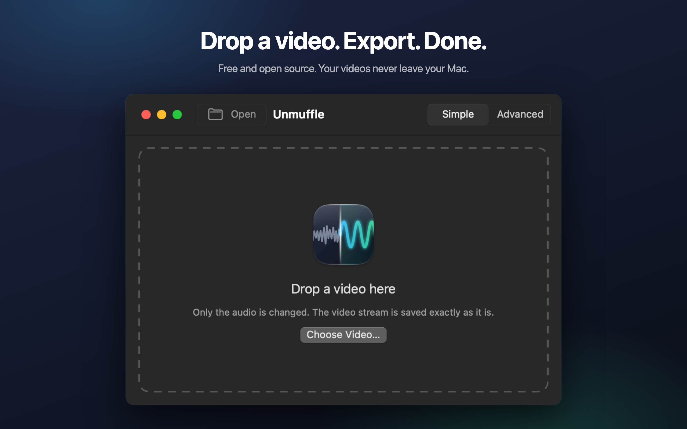

<p align="center"></p>

<h1 align="center">Unmuffle</h1>

<p align="center"><b>Clean up the voice in any video.</b><br>
A small, free Mac app that removes background noise, evens out the volume and makes speech clearer.<br>
The picture stays untouched.</p>

<p align="center">
  <a href="https://github.com/iAlborz/Unmuffle/releases/latest"></a>
  
  
  <a href="https://github.com/iAlborz/Unmuffle/releases"></a>
  <a href="LICENSE"></a>
</p>

<p align="center">
  <a href="https://github.com/iAlborz/Unmuffle/releases/latest/download/Unmuffle.zip"></a>
  &nbsp;
  <a href="https://apps.apple.com/app/unmuffle/id6825195286"></a>
</p>

<p align="center"><sub>Apple Silicon and Intel · macOS 14 or later · Notarized by Apple<br>
English · Español · Français · Deutsch · Italiano · Português · Nederlands · Polski · Русский · Türkçe · 日本語 · 한국어 · 简体中文 · 繁體中文</sub></p>

<p align="center"></p>

## What it does

Drop in a screen recording, a vlog or a video call. Unmuffle cleans up the sound and saves a copy.
The original stays as it was.

<table>
<tr>
<td width="33%" valign="top">
<h3>🔇 Removes noise</h3>
Hiss, hum and room noise. The aggressive setting also mutes the gaps between words.
</td>
<td width="33%" valign="top">
<h3>🎙️ Clearer voice</h3>
Evens out loud moments, brings the recording to a standard loudness, and can boost the speech range.
</td>
<td width="33%" valign="top">
<h3>🎬 Picture untouched</h3>
The video stream is copied byte for byte unless you cut something.
</td>
</tr>
<tr>
<td valign="top">
<h3>✂️ Trims</h3>
Drag the handles to trim, or let Unmuffle find the quiet parts and cut them.
</td>
<td valign="top">
<h3>🔒 Private</h3>
Everything happens on your Mac. Nothing is uploaded, and there are no accounts or tracking.
</td>
<td valign="top">
<h3>🔄 Updates itself</h3>
When a new version is out, a banner tells you. One click installs it.
</td>
</tr>
</table>

<table>
<tr>
<td></td>
<td></td>
</tr>
<tr>
<td align="center"><sub>Advanced mode shows every setting</sub></td>
<td align="center"><sub>Drop a video to start</sub></td>
</tr>
</table>

## Install

**Mac App Store:** get [Unmuffle on the Mac App Store](https://apps.apple.com/app/unmuffle/id6825195286).
The App Store keeps it up to date.

**GitHub:**

1. Download [`Unmuffle.zip`](https://github.com/iAlborz/Unmuffle/releases/latest/download/Unmuffle.zip)
   and drag `Unmuffle.app` to your Applications folder. Everything it needs is built in.
2. Open the app. It's notarized by Apple, so macOS opens it without a warning.

From version 1.3 on, the GitHub version updates itself. When a new version is out, a banner appears at
the top of the window. Click **Update** and Unmuffle downloads it, installs it and relaunches. You can
also choose **Unmuffle → Check for Updates…** at any time.

## How to use it

**Instant mode** is the quickest. Drop one or more videos on the window (or press ⌘O) and each one is
cleaned up with the choices on the right and saved next to the original as `name-1.mp4`. There's
nothing to confirm. The Mac App Store version asks once per folder for permission to save there.

Drop a video on the window (or press ⌘O). In Simple mode, the default, the video starts playing with
the cleanup applied, so you hear the result right away. Press **Export** and confirm where to save.
It suggests `name-1.mp4` next to the original (then `name-2`, and so on). Turn off **Auto-play** at
the bottom right if you'd rather start playback yourself.

**Simple mode** has three choices that work together:

- **Audio:** leave it as recorded, even out loud moments and bring it to a standard loudness, or mute it.
- **Voice:** no change, boost the speech range so the voice cuts through, or a fuller podcast tone.
- **Background Noise:** off, remove hiss, hum and room noise, or remove it aggressively and mute the
  gaps between words.

The choices stay set while the app is open, so a batch of recordings is drop, Export, drop, Export.

<details>
<summary><b>Advanced mode</b></summary>

- Noise reduction, noise gate, rumble and hiss cut, an 8-band EQ, a compressor, gain and loudness
  normalization. Each card has an ⓘ button that explains its settings.
- **Detect Noise** measures the noise floor and speech level and sets sensible values.
- Switch the player between **Original** and **Processed**. Processed streams the audio through the
  same ffmpeg filter chain that Export uses, starting from the playhead. Change a setting while it
  plays and the sound follows a moment later.
- The EQ is a graph with eight points. Drag a point up or down; double-click to reset it.
- Trim by dragging the yellow scissors handles on the waveform.
- **Trim Quiet Parts** finds silent parts. Red blocks are removed. Click a block to keep it.

</details>

<details>
<summary><b>How the noise reduction works</b></summary>

The denoiser is ffmpeg's `afftdn`, a spectral (FFT) noise reducer. It tracks the noise profile
continuously while the audio plays. "Detect Noise" measures the quiet parts found on the timeline
and uses their median level as the noise floor, then sets the reduction amount from the gap between
the noise floor and the voice level.

</details>

<details>
<summary><b>Video quality</b></summary>

- With no cuts, the video stream is **stream-copied**. It is byte for byte identical to the source.
- Trim or silence cuts change the timeline, so the video must be re-encoded. The Mac's hardware
  video encoder re-encodes it with the same codec and bitrate as the source. "Lossless trim" instead
  cuts at keyframes without re-encoding, so the cut points may be off by a few frames.

</details>

## Build from source

You need macOS 14 or later and Xcode or the Xcode Command Line Tools.

```bash
./build.sh
open build/Unmuffle.app
```

The first build also compiles the bundled ffmpeg from source with `scripts/build-ffmpeg.sh`, which
takes about 10 minutes. `./build.sh --universal` builds for both Apple Silicon and Intel.

<details>
<summary><b>GitHub and App Store versions</b></summary>

- `build.sh` builds the GitHub version: with [Sparkle](https://sparkle-project.org) updates and
  without the App Sandbox, so Sparkle can replace the app when it updates.
- `Unmuffle.xcodeproj` builds the Mac App Store version: sandboxed and without Sparkle, because the
  App Store updates its own apps. The update code is left out with `#if canImport(Sparkle)`.
- `swift run` also works for quick development; it uses ffmpeg from Homebrew (`brew install ffmpeg`)
  and doesn't check for updates.

</details>

<details>
<summary><b>Releasing a new version</b></summary>

1. Set the version and build number in the Xcode project (General tab).
2. Write the release notes in `docs/release-notes/<version>.md`.
3. Run `scripts/release.sh`. It builds `build/Unmuffle.zip`, signs it with the update key in your
   Keychain, and adds it to `appcast.xml`.
4. Publish the GitHub release with the zip, then commit and push `appcast.xml`. Apps already out
   there find the update within a day.

</details>

## Contributing

Issues and pull requests are welcome.

## Privacy

Unmuffle collects no data, and your videos never leave your Mac. The GitHub version checks GitHub for
a new version about once a day; the App Store version makes no network connections. See the
[privacy policy](PRIVACY.md).

## License

[MIT](LICENSE). Use it, change it, fork it, ship it.

Unmuffle includes [FFmpeg](https://ffmpeg.org) 9.0.2, licensed under the
[LGPL 2.1 or later](https://www.gnu.org/licenses/old-licenses/lgpl-2.1.html). It is built from the
unmodified official source by [`scripts/build-ffmpeg.sh`](scripts/build-ffmpeg.sh), with no GPL or
non-free parts enabled, and ships as separate libraries inside the app. The license text is in the
app at `Contents/Resources/FFmpeg-LICENSE.txt`. FFmpeg is a trademark of Fabrice Bellard.

The GitHub version includes [Sparkle](https://sparkle-project.org) for updates, under the
[MIT license](https://github.com/sparkle-project/Sparkle/blob/2.x/LICENSE). Its license text is in the
app at `Contents/Resources/Sparkle-LICENSE.txt`.
