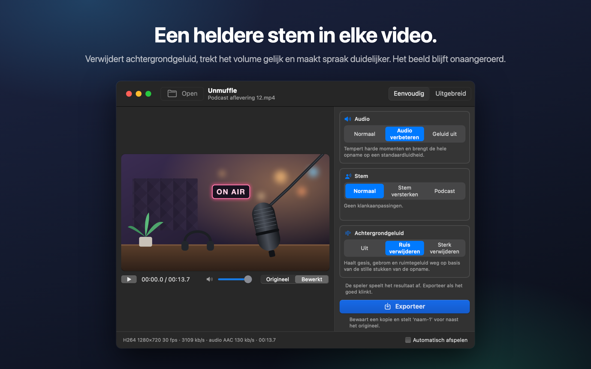
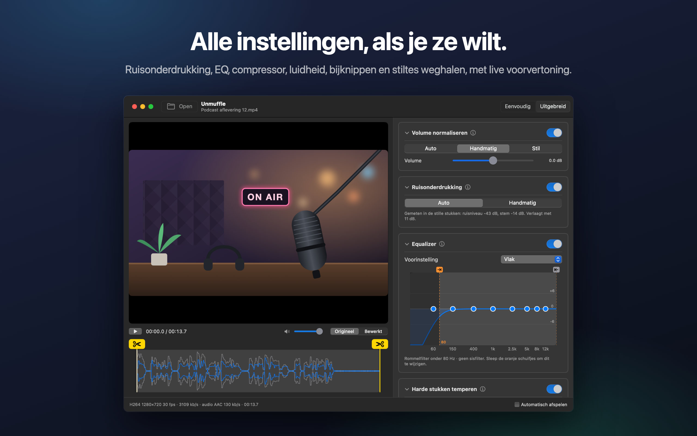
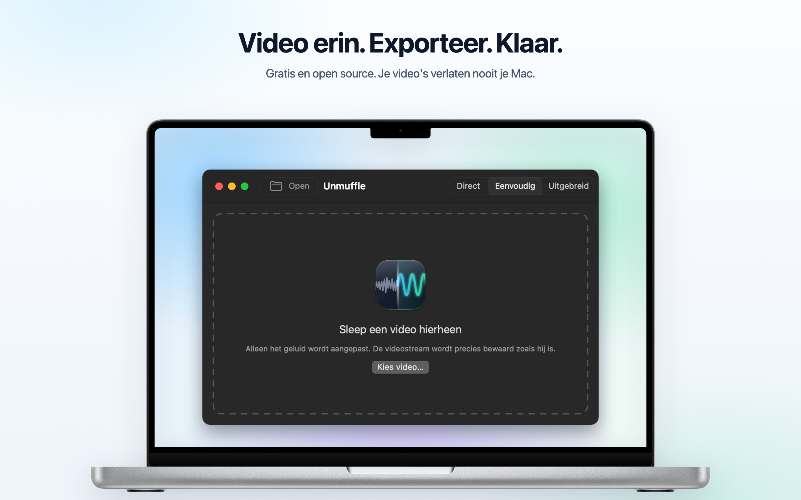

<h1 align="center">Unmuffle</h1>

<b>Maak de stem in elke video helder.</b> 
Een kleine, gratis Mac-app die achtergrondgeluid verwijdert, het volume gelijktrekt en spraak duidelijker maakt. 
Het beeld blijft onaangeroerd.

  
  
  
  

  
  &nbsp;
  

Apple Silicon en Intel · macOS 14 of nieuwer · Genotariseerd door Apple

🌐 <b>Nederlands</b> · 13 andere talen

 
🇺🇸&nbsp;<a href="README.md">English</a>&nbsp;&nbsp;·&nbsp; 🇪🇸&nbsp;<a href="README.es.md">Español</a>&nbsp;&nbsp;·&nbsp; 🇫🇷&nbsp;<a href="README.fr.md">Français</a>&nbsp;&nbsp;·&nbsp; 🇩🇪&nbsp;<a href="README.de.md">Deutsch</a>&nbsp;&nbsp;·&nbsp; 🇮🇹&nbsp;<a href="README.it.md">Italiano</a>&nbsp;&nbsp;·&nbsp; 🇧🇷&nbsp;<a href="README.pt-BR.md">Português</a>&nbsp;&nbsp;·&nbsp; 🇵🇱&nbsp;<a href="README.pl.md">Polski</a> 
🇷🇺&nbsp;<a href="README.ru.md">Русский</a>&nbsp;&nbsp;·&nbsp; 🇹🇷&nbsp;<a href="README.tr.md">Türkçe</a>&nbsp;&nbsp;·&nbsp; 🇯🇵&nbsp;<a href="README.ja.md">日本語</a>&nbsp;&nbsp;·&nbsp; 🇰🇷&nbsp;<a href="README.ko.md">한국어</a>&nbsp;&nbsp;·&nbsp; 🇨🇳&nbsp;<a href="README.zh-Hans.md">简体中文</a>&nbsp;&nbsp;·&nbsp; 🇹🇼&nbsp;<a href="README.zh-Hant.md">繁體中文</a>

## Wat Unmuffle doet

Sleep er een schermopname, vlog of videogesprek in. Unmuffle schoont het geluid op en bewaart een kopie.
Het origineel blijft zoals het was.

<table>
<tr>
<td width="33%" valign="top">
<h3>🔇 Verwijdert ruis</h3>
Gesis, gebrom en ruimtegeluid. De sterke instelling dempt ook de pauzes tussen woorden.
</td>
<td width="33%" valign="top">
<h3>🎙️ Heldere stem</h3>
Tempert harde momenten, brengt de opname op een standaardluidheid en kan het spraakbereik versterken.
</td>
<td width="33%" valign="top">
<h3>🎬 Beeld onaangeroerd</h3>
De videostream wordt byte voor byte gekopieerd, tenzij je iets wegknipt.
</td>
</tr>
<tr>
<td valign="top">
<h3>✂️ Knipt bij</h3>
Sleep de grepen om bij te knippen, of laat Unmuffle de stille stukken zoeken en wegknippen.
</td>
<td valign="top">
<h3>🔒 Privé</h3>
Alles gebeurt op je Mac. Er wordt niets geüpload, en er zijn geen accounts of tracking.
</td>
<td valign="top">
<h3>🔄 Werkt zichzelf bij</h3>
Is er een nieuwe versie, dan laat een banner het je weten. Met één klik is die geïnstalleerd.
</td>
</tr>
</table>

<table>
<tr>
<td></td>
<td></td>
</tr>
<tr>
<td align="center">De modus ‘Uitgebreid’ toont alle instellingen</td>
<td align="center">Sleep een video erin om te beginnen</td>
</tr>
</table>

## Installeren

**Mac App Store:** download [Unmuffle in de Mac App Store](https://apps.apple.com/app/unmuffle/id6825195286).
De App Store houdt de app up-to-date.

**GitHub:**

1. Download [`Unmuffle.zip`](https://github.com/iAlborz/Unmuffle/releases/latest/download/Unmuffle.zip)
   en sleep `Unmuffle.app` naar je map Apps. Alles wat de app nodig heeft, zit erin.
2. Open de app. Hij is genotariseerd door Apple, dus macOS opent hem zonder waarschuwing.

Vanaf versie 1.3 werkt de GitHub-versie zichzelf bij. Is er een nieuwe versie, dan verschijnt er bovenaan
het venster een banner. Klik op **Werk bij**: Unmuffle downloadt de update, installeert die en start
opnieuw op. Je kunt ook altijd **Unmuffle → Controleer op updates…** kiezen.

## Gebruik

**De modus ‘Direct’** is het snelst. Sleep een of meer video's naar het venster (of druk op ⌘O). Elke video
wordt opgeschoond met de keuzes rechts en naast het origineel bewaard als `naam-1.mp4`. Je hoeft niets te
bevestigen. De versie uit de Mac App Store vraagt één keer per map of hij daar mag bewaren.

Sleep een video naar het venster (of druk op ⌘O). In de modus ‘Eenvoudig’, de standaard, begint de video
meteen te spelen met de verbeteringen erop. Zo hoor je het resultaat direct. Klik op **Exporteer** en
bevestig waar je hem wilt bewaren. Unmuffle stelt `naam-1.mp4` naast het origineel voor (daarna `naam-2`,
enzovoort). Zet **Automatisch afspelen** rechtsonder uit als je het afspelen liever zelf start.

**De modus ‘Eenvoudig’** heeft drie keuzes die samenwerken:

- **Audio:** laten zoals het is opgenomen; harde momenten temperen en op een standaardluidheid brengen;
  of het geluid uitzetten.
- **Stem:** niets veranderen; het spraakbereik versterken zodat de stem goed doorkomt; of een vollere
  podcastklank.
- **Achtergrondgeluid:** uit; gesis, gebrom en ruimtegeluid verwijderen; of alles sterk verwijderen en de
  pauzes tussen woorden dempen.

De keuzes blijven staan zolang de app open is. Een hele stapel opnames gaat dus zo: slepen, Exporteer,
slepen, Exporteer.

<b>Modus ‘Uitgebreid’</b>

- Ruisonderdrukking, noise gate, rommel- en sisfilter, een 8-bands equalizer, een compressor, versterking
  en luidheidsnormalisatie. Elke kaart heeft een ⓘ-knop die de instellingen uitlegt.
- **Detecteer ruis** meet het ruisniveau en het spraakniveau en kiest verstandige waarden.
- Wissel in de speler tussen **Origineel** en **Bewerkt**. ‘Bewerkt’ stuurt het geluid vanaf de afspeelkop
  door dezelfde ffmpeg-filterketen die ook bij het exporteren wordt gebruikt. Verander je een instelling
  tijdens het afspelen, dan volgt het geluid een moment later.
- De EQ is een grafiek met acht punten. Sleep een punt omhoog of omlaag; dubbelklik om het te herstellen.
- Knip bij door de gele grepen met de schaar op de golfvorm te slepen.
- **Stille stukken wegknippen** zoekt stiltes op. Rode blokken worden verwijderd. Klik op een blok om het
  te behouden.

<b>Zo werkt de ruisonderdrukking</b>

De ruisonderdrukking gebruikt `afftdn` van ffmpeg, een spectraal ruisfilter (FFT). Het filter volgt het
ruisprofiel doorlopend terwijl het geluid speelt. ‘Detecteer ruis’ meet de stille stukken op de tijdlijn
en neemt hun mediane niveau als ruisniveau. Daarna bepaalt het hoe sterk de onderdrukking is, op basis
van het verschil tussen het ruisniveau en het stemniveau.

<b>Videokwaliteit</b>

- Zonder knippen wordt de videostream **ongewijzigd gekopieerd** (stream copy). Hij is byte voor byte
  gelijk aan de bron.
- Bijknippen of stiltes weghalen verandert de tijdlijn, dus de video moet opnieuw worden gecodeerd. De
  hardware-video-encoder van de Mac doet dat met dezelfde codec en bitsnelheid als de bron.
  ‘Verliesvrij knippen’ knipt in plaats daarvan bij keyframes, zonder opnieuw te coderen. De knippunten
  kunnen dan een paar frames verschoven zijn.

## Voor ontwikkelaars

Wil je Unmuffle zelf bouwen, een versie uitbrengen of bijdragen? Kijk dan in de
[Engelse README](README.md#build-from-source). Issues en pull requests zijn welkom.

## Privacy

Unmuffle verzamelt geen gegevens en je video's verlaten nooit je Mac. De GitHub-versie kijkt ongeveer één
keer per dag op GitHub of er een nieuwe versie is; de App Store-versie maakt geen netwerkverbindingen.
Zie het [privacybeleid](PRIVACY.md) (in het Engels).

## Licentie

[MIT](LICENSE). Gebruik het, pas het aan, fork het, verspreid het.

Unmuffle bevat [FFmpeg](https://ffmpeg.org) 9.0.2, onder de
[LGPL 2.1 of later](https://www.gnu.org/licenses/old-licenses/lgpl-2.1.html). Het wordt met
[`scripts/build-ffmpeg.sh`](scripts/build-ffmpeg.sh) gebouwd uit de ongewijzigde officiële broncode,
zonder GPL- of niet-vrije onderdelen, en zit als losse bibliotheken in de app. De licentietekst staat in
de app in `Contents/Resources/FFmpeg-LICENSE.txt`. FFmpeg is een handelsmerk van Fabrice Bellard.

De GitHub-versie bevat [Sparkle](https://sparkle-project.org) voor updates, onder de
[MIT-licentie](https://github.com/sparkle-project/Sparkle/blob/2.x/LICENSE). De licentietekst daarvan
staat in de app in `Contents/Resources/Sparkle-LICENSE.txt`.
