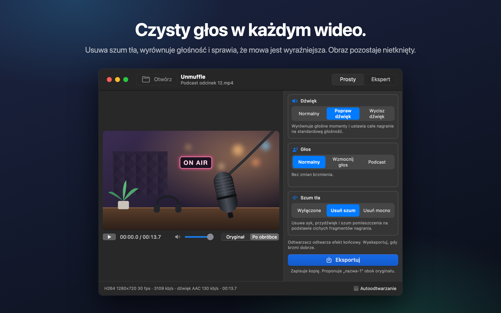
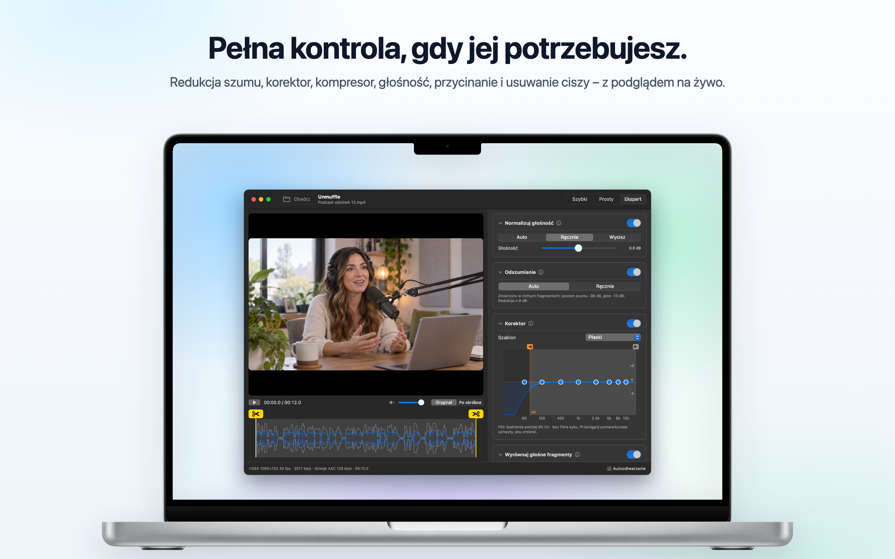
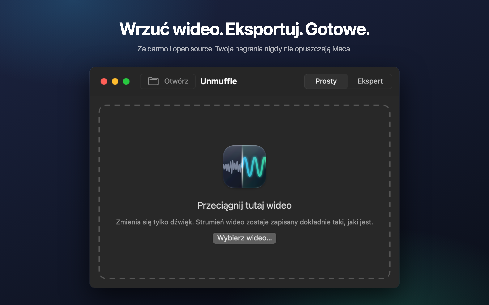

<h1 align="center">Unmuffle</h1>

<b>Oczyść głos w każdym wideo.</b> 
Mała, darmowa aplikacja na Maca, która usuwa szum tła, wyrównuje głośność i sprawia, że mowa jest wyraźniejsza. 
Obraz pozostaje nietknięty.

  
  
  
  

  
  &nbsp;
  

Apple Silicon i Intel · macOS 14 lub nowszy · Notaryzowana przez Apple

🌐 <b>Polski</b> · 13 innych języków

 
🇺🇸&nbsp;<a href="README.md">English</a>&nbsp;&nbsp;·&nbsp; 🇪🇸&nbsp;<a href="README.es.md">Español</a>&nbsp;&nbsp;·&nbsp; 🇫🇷&nbsp;<a href="README.fr.md">Français</a>&nbsp;&nbsp;·&nbsp; 🇩🇪&nbsp;<a href="README.de.md">Deutsch</a>&nbsp;&nbsp;·&nbsp; 🇮🇹&nbsp;<a href="README.it.md">Italiano</a>&nbsp;&nbsp;·&nbsp; 🇧🇷&nbsp;<a href="README.pt-BR.md">Português</a>&nbsp;&nbsp;·&nbsp; 🇳🇱&nbsp;<a href="README.nl.md">Nederlands</a> 
🇷🇺&nbsp;<a href="README.ru.md">Русский</a>&nbsp;&nbsp;·&nbsp; 🇹🇷&nbsp;<a href="README.tr.md">Türkçe</a>&nbsp;&nbsp;·&nbsp; 🇯🇵&nbsp;<a href="README.ja.md">日本語</a>&nbsp;&nbsp;·&nbsp; 🇰🇷&nbsp;<a href="README.ko.md">한국어</a>&nbsp;&nbsp;·&nbsp; 🇨🇳&nbsp;<a href="README.zh-Hans.md">简体中文</a>&nbsp;&nbsp;·&nbsp; 🇹🇼&nbsp;<a href="README.zh-Hant.md">繁體中文</a>

## Co robi Unmuffle

Przeciągnij nagranie ekranu, vloga albo rozmowę wideo. Unmuffle oczyszcza dźwięk i zapisuje kopię.
Oryginał zostaje taki, jaki był.

<table>
<tr>
<td width="33%" valign="top">
<h3>🔇 Usuwa szum</h3>
Syk, przydźwięk i szum pomieszczenia. Mocne ustawienie wycisza też przerwy między słowami.
</td>
<td width="33%" valign="top">
<h3>🎙️ Wyraźniejszy głos</h3>
Wyrównuje głośne momenty, ustawia nagranie na standardową głośność i może podbić zakres mowy.
</td>
<td width="33%" valign="top">
<h3>🎬 Obraz nietknięty</h3>
Strumień wideo jest kopiowany bajt po bajcie, chyba że coś wytniesz.
</td>
</tr>
<tr>
<td valign="top">
<h3>✂️ Przycina</h3>
Przeciągnij uchwyty, aby przyciąć, albo pozwól, żeby Unmuffle sam znalazł ciche fragmenty i je wyciął.
</td>
<td valign="top">
<h3>🔒 Prywatnie</h3>
Wszystko dzieje się na twoim Macu. Nic nie jest wysyłane, nie ma kont ani śledzenia.
</td>
<td valign="top">
<h3>🔄 Sam się aktualizuje</h3>
Gdy wyjdzie nowa wersja, powie ci o tym baner. Instalacja to jedno kliknięcie.
</td>
</tr>
</table>

<table>
<tr>
<td></td>
<td></td>
</tr>
<tr>
<td align="center">Tryb „Ekspert” pokazuje wszystkie ustawienia</td>
<td align="center">Przeciągnij wideo, aby zacząć</td>
</tr>
</table>

## Instalacja

**Mac App Store:** pobierz [Unmuffle z Mac App Store](https://apps.apple.com/app/unmuffle/id6825195286).
App Store sam dba o aktualizacje.

**GitHub:**

1. Pobierz [`Unmuffle.zip`](https://github.com/iAlborz/Unmuffle/releases/latest/download/Unmuffle.zip)
   i przeciągnij `Unmuffle.app` do folderu Aplikacje. Wszystko, czego potrzebuje, ma już w sobie.
2. Otwórz aplikację. Jest notaryzowana przez Apple, więc macOS otworzy ją bez ostrzeżenia.

Od wersji 1.3 aplikacja pobrana z GitHuba aktualizuje się sama. Gdy wyjdzie nowa wersja, u góry okna
pojawi się baner. Kliknij **Uaktualnij**, a Unmuffle pobierze ją, zainstaluje i uruchomi się ponownie.
Możesz też wybrać **Unmuffle → Sprawdź uaktualnienia…** w dowolnym momencie.

## Jak używać

**Tryb „Szybki”** to najkrótsza droga. Przeciągnij jedno lub kilka wideo do okna (albo naciśnij ⌘O).
Każde zostanie oczyszczone według opcji po prawej i zapisane obok oryginału jako `nazwa-1.mp4`. Nie trzeba
niczego potwierdzać. Wersja z Mac App Store raz na folder prosi o pozwolenie na zapis w nim.

Przeciągnij wideo do okna (albo naciśnij ⌘O). W trybie „Prosty”, który jest domyślny, wideo zaczyna się
odtwarzać już z poprawkami, więc od razu słyszysz efekt. Kliknij **Eksportuj** i potwierdź, gdzie zapisać
plik. Unmuffle proponuje `nazwa-1.mp4` obok oryginału (potem `nazwa-2` i tak dalej). Wyłącz
**Autoodtwarzanie** w prawym dolnym rogu, jeśli wolisz uruchamiać odtwarzanie ręcznie.

**Tryb „Prosty”** ma trzy opcje, które działają razem:

- **Dźwięk:** tak, jak został nagrany; wyrównanie głośnych momentów i ustawienie standardowej głośności;
  albo wyciszenie.
- **Głos:** bez zmian; podbicie zakresu mowy, żeby głos się przebijał; albo pełniejsze, podcastowe brzmienie.
- **Szum tła:** wyłączone; usuwanie syku, przydźwięku i szumu pomieszczenia; albo mocne usuwanie
  z wyciszaniem przerw między słowami.

Opcje zostają ustawione, dopóki aplikacja jest otwarta, więc cała partia nagrań to: przeciągnij, Eksportuj,
przeciągnij, Eksportuj.

<b>Tryb „Ekspert”</b>

- Redukcja szumu, bramka szumów, filtry dudnienia i syku, 8-pasmowy korektor, kompresor, wzmocnienie
  i normalizacja głośności. Każda karta ma przycisk ⓘ, który objaśnia jej ustawienia.
- **Wykryj szum** mierzy poziom szumu i poziom mowy, a potem ustawia rozsądne wartości.
- Przełączaj odtwarzacz między **Oryginał** i **Po obróbce**. „Po obróbce” przepuszcza dźwięk od pozycji
  głowicy odtwarzania przez ten sam łańcuch filtrów ffmpeg, którego używa eksport. Zmień ustawienie
  w trakcie odtwarzania, a dźwięk dostosuje się chwilę później.
- Korektor to wykres z ośmioma punktami. Przeciągnij punkt w górę lub w dół; kliknij go dwukrotnie, aby
  go wyzerować.
- Przycinaj, przeciągając żółte uchwyty z nożyczkami na przebiegu fali.
- **Wytnij ciche fragmenty** wyszukuje ciszę. Czerwone bloki zostaną usunięte. Kliknij blok, aby zachować
  ten fragment.

<b>Jak działa redukcja szumu</b>

Za redukcję szumu odpowiada `afftdn` z ffmpeg, widmowy reduktor szumu oparty na FFT. Śledzi on profil
szumu na bieżąco podczas odtwarzania. „Wykryj szum” mierzy ciche fragmenty znalezione na osi czasu
i przyjmuje ich medianę jako poziom szumu. Potem ustala siłę redukcji na podstawie różnicy między
poziomem szumu a poziomem głosu.

<b>Jakość wideo</b>

- Bez cięć strumień wideo jest **kopiowany bez zmian** (stream copy). Jest identyczny ze źródłem bajt
  po bajcie.
- Przycięcie lub wycięcie ciszy zmienia oś czasu, więc wideo trzeba zakodować ponownie. Sprzętowy koder
  wideo Maca robi to tym samym kodekiem i z tą samą przepływnością co źródło. „Cięcie bezstratne” tnie
  zamiast tego przy klatkach kluczowych, bez ponownego kodowania, więc punkty cięcia mogą się przesunąć
  o kilka klatek.

## Dla programistów

Jak zbudować Unmuffle ze źródeł, wydać nową wersję albo pomóc w rozwoju, opisuje
[README po angielsku](README.md#build-from-source). Zgłoszenia (issues) i pull requesty są mile widziane.

## Prywatność

Unmuffle nie zbiera żadnych danych, a twoje nagrania nigdy nie opuszczają Maca. Wersja z GitHuba mniej
więcej raz dziennie sprawdza na GitHubie, czy jest nowa wersja; wersja z App Store nie łączy się z siecią.
Szczegóły w [polityce prywatności](PRIVACY.md) (po angielsku).

## Licencja

[MIT](LICENSE). Używaj, zmieniaj, forkuj, rozpowszechniaj.

Unmuffle zawiera [FFmpeg](https://ffmpeg.org) 9.0.2 na licencji
[LGPL 2.1 lub nowszej](https://www.gnu.org/licenses/old-licenses/lgpl-2.1.html). Jest on budowany
z niezmodyfikowanego oficjalnego kodu źródłowego przez [`scripts/build-ffmpeg.sh`](scripts/build-ffmpeg.sh),
bez włączonych części GPL ani niewolnych, i dołączany do aplikacji jako osobne biblioteki. Tekst licencji
znajduje się w aplikacji w `Contents/Resources/FFmpeg-LICENSE.txt`. FFmpeg jest znakiem towarowym
Fabrice'a Bellarda.

Wersja z GitHuba zawiera [Sparkle](https://sparkle-project.org) do aktualizacji, na
[licencji MIT](https://github.com/sparkle-project/Sparkle/blob/2.x/LICENSE). Tekst tej licencji znajduje się
w aplikacji w `Contents/Resources/Sparkle-LICENSE.txt`.
