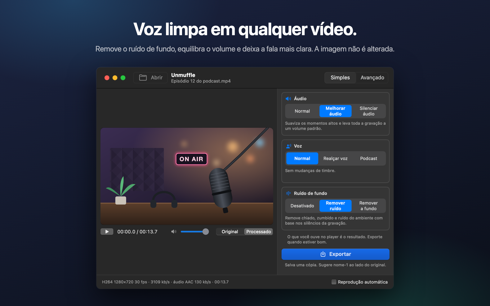
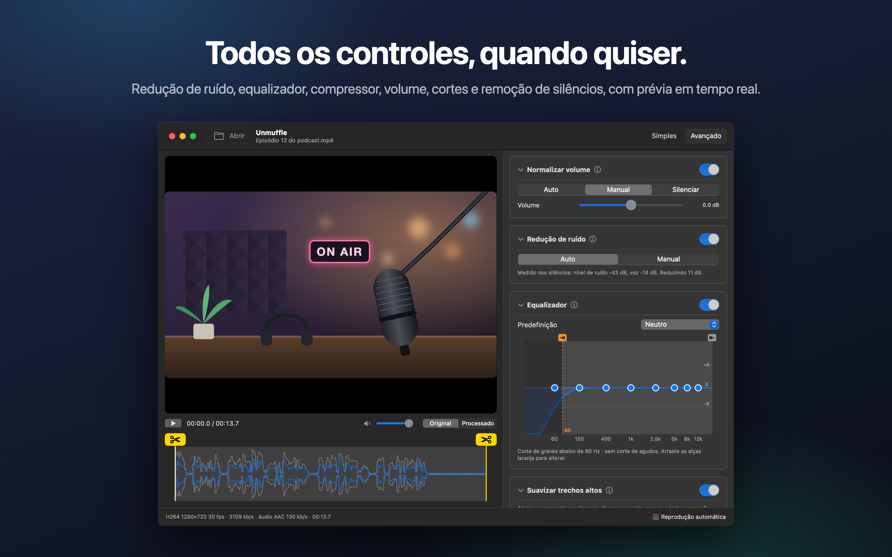
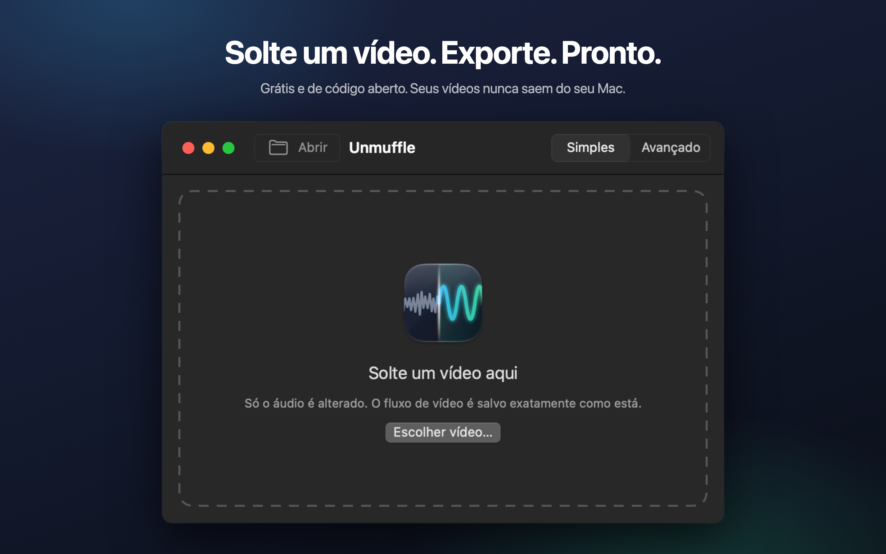

<h1 align="center">Unmuffle</h1>

<b>Limpe a voz de qualquer vídeo.</b> 
Um app pequeno e gratuito para Mac que remove o ruído de fundo, equilibra o volume e deixa a fala mais clara. 
A imagem não é alterada.

  
  
  
  

  
  &nbsp;
  

Apple Silicon e Intel · macOS 14 ou posterior · Notarizado pela Apple

🌐 <b>Português</b> · mais 13 idiomas

 
🇺🇸&nbsp;<a href="README.md">English</a>&nbsp;&nbsp;·&nbsp; 🇪🇸&nbsp;<a href="README.es.md">Español</a>&nbsp;&nbsp;·&nbsp; 🇫🇷&nbsp;<a href="README.fr.md">Français</a>&nbsp;&nbsp;·&nbsp; 🇩🇪&nbsp;<a href="README.de.md">Deutsch</a>&nbsp;&nbsp;·&nbsp; 🇮🇹&nbsp;<a href="README.it.md">Italiano</a>&nbsp;&nbsp;·&nbsp; 🇳🇱&nbsp;<a href="README.nl.md">Nederlands</a>&nbsp;&nbsp;·&nbsp; 🇵🇱&nbsp;<a href="README.pl.md">Polski</a> 
🇷🇺&nbsp;<a href="README.ru.md">Русский</a>&nbsp;&nbsp;·&nbsp; 🇹🇷&nbsp;<a href="README.tr.md">Türkçe</a>&nbsp;&nbsp;·&nbsp; 🇯🇵&nbsp;<a href="README.ja.md">日本語</a>&nbsp;&nbsp;·&nbsp; 🇰🇷&nbsp;<a href="README.ko.md">한국어</a>&nbsp;&nbsp;·&nbsp; 🇨🇳&nbsp;<a href="README.zh-Hans.md">简体中文</a>&nbsp;&nbsp;·&nbsp; 🇹🇼&nbsp;<a href="README.zh-Hant.md">繁體中文</a>

## O que ele faz

Solte uma gravação de tela, um vlog ou uma chamada de vídeo. O Unmuffle limpa o som e salva uma cópia.
O original fica como estava.

<table>
<tr>
<td width="33%" valign="top">
<h3>🔇 Remove o ruído</h3>
Chiado, zumbido e ruído do ambiente. A opção mais forte também silencia os intervalos entre as palavras.
</td>
<td width="33%" valign="top">
<h3>🎙️ Voz mais clara</h3>
Suaviza os momentos altos, leva a gravação a um volume padrão e pode realçar a faixa da voz.
</td>
<td width="33%" valign="top">
<h3>🎬 Imagem intacta</h3>
O fluxo de vídeo é copiado byte a byte, a menos que você corte algo.
</td>
</tr>
<tr>
<td valign="top">
<h3>✂️ Corta</h3>
Arraste as alças para cortar, ou deixe o Unmuffle encontrar os silêncios e removê-los.
</td>
<td valign="top">
<h3>🔒 Privado</h3>
Tudo acontece no seu Mac. Nada é enviado para a internet, e não há contas nem rastreamento.
</td>
<td valign="top">
<h3>🔄 Atualiza sozinho</h3>
Quando sai uma versão nova, um aviso aparece. Basta um clique para instalar.
</td>
</tr>
</table>

<table>
<tr>
<td></td>
<td></td>
</tr>
<tr>
<td align="center">O modo Avançado mostra todos os ajustes</td>
<td align="center">Solte um vídeo para começar</td>
</tr>
</table>

## Instalação

**Mac App Store:** baixe o [Unmuffle na Mac App Store](https://apps.apple.com/app/unmuffle/id6825195286).
A App Store mantém o app atualizado.

**GitHub:**

1. Baixe o [`Unmuffle.zip`](https://github.com/iAlborz/Unmuffle/releases/latest/download/Unmuffle.zip)
   e arraste o `Unmuffle.app` para a pasta Aplicativos. Não é preciso instalar mais nada.
2. Abra o app. Ele é notarizado pela Apple, então o macOS abre sem nenhum aviso.

A partir da versão 1.3, a versão do GitHub se atualiza sozinha. Quando sai uma versão nova, aparece um
aviso no topo da janela. Clique em **Atualizar** e o Unmuffle baixa a atualização, instala e reabre. Você
também pode escolher **Unmuffle → Buscar Atualizações…** a qualquer momento.

## Como usar

**O modo Instantâneo** é o mais rápido. Solte um ou mais vídeos na janela (ou pressione ⌘O) e cada um é
limpo com as opções à direita e salvo ao lado do original como `nome-1.mp4`. Não há nada para confirmar.
A versão da Mac App Store pede permissão uma vez por pasta para salvar nela.

Solte um vídeo na janela (ou pressione ⌘O). No modo Simples, que é o padrão, o vídeo começa a tocar com
a limpeza aplicada, então você ouve o resultado na hora. Clique em **Exportar** e confirme onde salvar. O
app sugere `nome-1.mp4` ao lado do original (depois `nome-2`, e assim por diante). Desative
**Reprodução automática** no canto inferior direito se preferir iniciar a reprodução você mesmo.

**O modo Simples** tem três opções que funcionam juntas:

- **Áudio:** deixar como foi gravado, suavizar os momentos altos e levar a um volume padrão, ou
  silenciar.
- **Voz:** sem mudança, realçar a faixa da fala para a voz se destacar, ou um tom de podcast mais
  encorpado.
- **Ruído de fundo:** desativado, remover chiado, zumbido e ruído do ambiente, ou remover a fundo e
  silenciar os intervalos entre as palavras.

As opções continuam valendo enquanto o app estiver aberto, então uma leva de gravações vira: soltar,
Exportar, soltar, Exportar.

<b>Modo Avançado</b>

- Redução de ruído, noise gate, corte de graves e agudos, um equalizador de 8 bandas, um compressor,
  ganho e normalização de volume. Cada cartão tem um botão ⓘ que explica os ajustes dele.
- **Detectar ruído** mede o nível do ruído e o da voz e define valores adequados.
- Alterne o player entre **Original** e **Processado**. O Processado passa o áudio pela mesma cadeia de
  filtros do ffmpeg que o Exportar usa, a partir do indicador de reprodução. Mude um ajuste durante a
  reprodução e o som acompanha um instante depois.
- O equalizador é um gráfico com oito pontos. Arraste um ponto para cima ou para baixo; clique duas
  vezes para redefini-lo.
- Para cortar, arraste as alças amarelas com tesouras na forma de onda.
- **Cortar silêncios** encontra os trechos em silêncio. Os blocos vermelhos são removidos. Clique em um
  bloco para mantê-lo.

<b>Como funciona a redução de ruído</b>

O redutor de ruído é o `afftdn` do ffmpeg, um redutor de ruído espectral (FFT). Ele acompanha o perfil
do ruído continuamente enquanto o áudio toca. “Detectar ruído” mede os silêncios encontrados na linha do
tempo e usa o nível mediano deles como nível de ruído. Depois, define a intensidade da redução pela
diferença entre o nível de ruído e o nível da voz.

<b>Qualidade do vídeo</b>

- Sem cortes, o fluxo de vídeo é **copiado sem alterações** (stream copy). Ele fica idêntico ao original,
  byte a byte.
- Cortes e remoção de silêncios mudam a linha do tempo, então o vídeo precisa ser recodificado. O
  codificador de vídeo por hardware do Mac recodifica o vídeo com o mesmo codec e a mesma taxa de bits do
  original. Já o “Corte sem perda” corta nos quadros-chave sem recodificar, então os pontos de corte
  podem ficar alguns quadros fora do lugar.

## Para desenvolvedores

Para compilar o Unmuffle a partir do código-fonte, publicar uma versão ou contribuir, veja o
[README em inglês](README.md#build-from-source). Issues e pull requests são bem-vindos.

## Privacidade

O Unmuffle não coleta dados, e seus vídeos nunca saem do seu Mac. A versão do GitHub consulta o GitHub
cerca de uma vez por dia para ver se há uma versão nova; a versão da App Store não faz nenhuma conexão de
rede. Veja a [política de privacidade](PRIVACY.md) (em inglês).

## Licença

[MIT](LICENSE). Use, modifique, faça um fork, distribua.

O Unmuffle inclui o [FFmpeg](https://ffmpeg.org) 9.0.2, sob a licença
[LGPL 2.1 ou posterior](https://www.gnu.org/licenses/old-licenses/lgpl-2.1.html). Ele é compilado a
partir do código-fonte oficial, sem modificações, pelo [`scripts/build-ffmpeg.sh`](scripts/build-ffmpeg.sh),
sem nenhuma parte GPL ou não livre ativada, e vai incluído no app como bibliotecas separadas. O texto da
licença está no app, em `Contents/Resources/FFmpeg-LICENSE.txt`. FFmpeg é uma marca comercial de
Fabrice Bellard.

A versão do GitHub inclui o [Sparkle](https://sparkle-project.org) para as atualizações, sob a
[licença MIT](https://github.com/sparkle-project/Sparkle/blob/2.x/LICENSE). O texto da licença dele está
no app, em `Contents/Resources/Sparkle-LICENSE.txt`.
