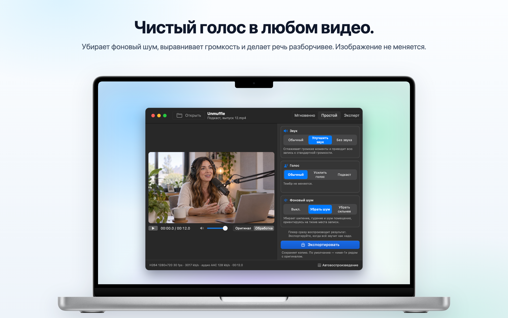
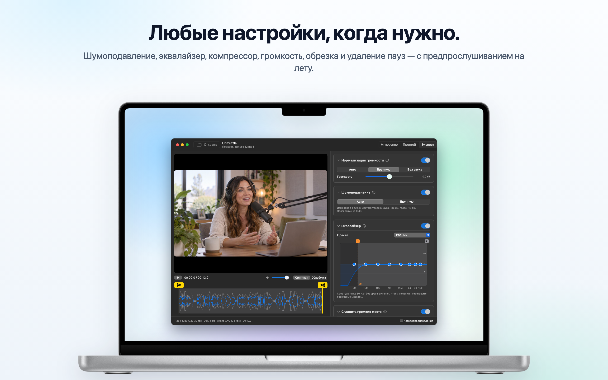
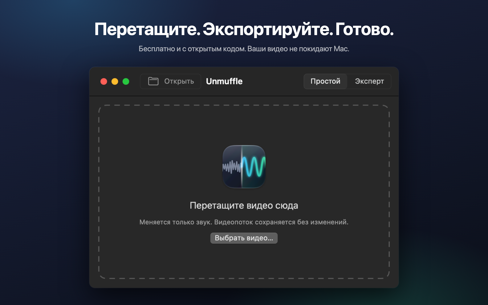

<h1 align="center">Unmuffle</h1>

<b>Чистый голос в любом видео.</b> 
Небольшое бесплатное приложение для Mac: убирает фоновый шум, выравнивает громкость и делает речь разборчивее. 
Изображение остаётся прежним.

  
  
  
  

  
  &nbsp;
  

Apple Silicon и Intel · macOS 14 или новее · Нотаризовано Apple

🌐 <b>Русский</b> · ещё 13 языков

 
🇺🇸&nbsp;<a href="README.md">English</a>&nbsp;&nbsp;·&nbsp; 🇪🇸&nbsp;<a href="README.es.md">Español</a>&nbsp;&nbsp;·&nbsp; 🇫🇷&nbsp;<a href="README.fr.md">Français</a>&nbsp;&nbsp;·&nbsp; 🇩🇪&nbsp;<a href="README.de.md">Deutsch</a>&nbsp;&nbsp;·&nbsp; 🇮🇹&nbsp;<a href="README.it.md">Italiano</a>&nbsp;&nbsp;·&nbsp; 🇧🇷&nbsp;<a href="README.pt-BR.md">Português</a>&nbsp;&nbsp;·&nbsp; 🇳🇱&nbsp;<a href="README.nl.md">Nederlands</a> 
🇵🇱&nbsp;<a href="README.pl.md">Polski</a>&nbsp;&nbsp;·&nbsp; 🇹🇷&nbsp;<a href="README.tr.md">Türkçe</a>&nbsp;&nbsp;·&nbsp; 🇯🇵&nbsp;<a href="README.ja.md">日本語</a>&nbsp;&nbsp;·&nbsp; 🇰🇷&nbsp;<a href="README.ko.md">한국어</a>&nbsp;&nbsp;·&nbsp; 🇨🇳&nbsp;<a href="README.zh-Hans.md">简体中文</a>&nbsp;&nbsp;·&nbsp; 🇹🇼&nbsp;<a href="README.zh-Hant.md">繁體中文</a>

## Что умеет Unmuffle

Перетащите запись экрана, влог или видеозвонок. Unmuffle очистит звук и сохранит копию.
Оригинал останется как был.

<table>
<tr>
<td width="33%" valign="top">
<h3>🔇 Убирает шум</h3>
Шипение, гудение и шум помещения. Сильная настройка вдобавок глушит паузы между словами.
</td>
<td width="33%" valign="top">
<h3>🎙️ Чёткий голос</h3>
Сглаживает громкие моменты, приводит запись к стандартной громкости и может усилить речевой диапазон.
</td>
<td width="33%" valign="top">
<h3>🎬 Изображение не меняется</h3>
Видеопоток копируется байт в байт, если вы ничего не вырезаете.
</td>
</tr>
<tr>
<td valign="top">
<h3>✂️ Обрезает</h3>
Перетащите маркеры, чтобы обрезать видео, или пусть Unmuffle сам найдёт тихие места и вырежет их.
</td>
<td valign="top">
<h3>🔒 Приватно</h3>
Всё происходит на вашем Mac. Ничего не загружается в сеть, нет ни аккаунтов, ни отслеживания.
</td>
<td valign="top">
<h3>🔄 Обновляется сам</h3>
Когда выходит новая версия, появляется уведомление. Установка в один клик.
</td>
</tr>
</table>

<table>
<tr>
<td></td>
<td></td>
</tr>
<tr>
<td align="center">В режиме «Эксперт» видны все настройки</td>
<td align="center">Перетащите видео, чтобы начать</td>
</tr>
</table>

## Установка

**Mac App Store:** скачайте [Unmuffle в Mac App Store](https://apps.apple.com/app/unmuffle/id6825195286).
App Store сам будет его обновлять.

**GitHub:**

1. Скачайте [`Unmuffle.zip`](https://github.com/iAlborz/Unmuffle/releases/latest/download/Unmuffle.zip)
   и перетащите `Unmuffle.app` в папку «Программы». Всё нужное уже внутри.
2. Откройте приложение. Оно нотаризовано Apple, поэтому macOS открывает его без предупреждений.

Начиная с версии 1.3, Unmuffle с GitHub обновляется сам. Когда выходит новая версия, вверху окна
появляется уведомление. Нажмите **Обновить**, и Unmuffle скачает её, установит и перезапустится.
Проверить обновления можно и вручную в любой момент: **Unmuffle → Проверить обновления…**

## Как пользоваться

**Режим «Мгновенно»** самый быстрый. Перетащите в окно одно или несколько видео (или нажмите ⌘O):
каждое очистится с настройками, выбранными справа, и сохранится рядом с оригиналом как `имя-1.mp4`.
Подтверждать ничего не нужно. Версия из Mac App Store один раз для каждой папки спросит разрешение
сохранять в неё.

Перетащите видео в окно (или нажмите ⌘O). В режиме «Простой», который включён по умолчанию, видео
начинает играть уже с обработкой, и результат слышен сразу. Нажмите **Экспортировать** и подтвердите,
куда сохранить. Unmuffle предложит `имя-1.mp4` рядом с оригиналом (потом `имя-2` и так далее). Если
хотите запускать воспроизведение сами, выключите **Автовоспроизведение** справа внизу.

**В режиме «Простой»** три настройки, которые работают вместе:

- **Звук:** оставить как записано, сгладить громкие моменты и привести к стандартной громкости или выключить звук.
- **Голос:** без изменений, усилить речевой диапазон, чтобы голос звучал отчётливее, или более плотный тембр, как в подкасте.
- **Фоновый шум:** не трогать, убрать шипение, гудение и шум помещения или убрать сильнее, заодно заглушив
  паузы между словами.

Настройки сохраняются, пока приложение открыто, так что серия записей обрабатывается просто: перетащить,
«Экспортировать», перетащить, «Экспортировать».

<b>Режим «Эксперт»</b>

- Шумоподавление, шумовой гейт, срез гула и шипения, 8-полосный эквалайзер, компрессор, усиление и
  нормализация громкости. На каждой карточке есть кнопка ⓘ, которая объясняет её настройки.
- Кнопка **Измерить шум** определяет уровень шума и уровень речи и выставляет разумные значения.
- Переключайте плеер между режимами **Оригинал** и **Обработка**. В режиме «Обработка» звук идёт через
  ту же цепочку фильтров ffmpeg, что и при экспорте, начиная с позиции воспроизведения. Если поменять
  настройку во время воспроизведения, звук изменится через мгновение.
- Эквалайзер выглядит как график с восемью точками. Перетаскивайте точку вверх или вниз, двойной щелчок
  сбрасывает её.
- Чтобы обрезать видео, перетащите жёлтые маркеры с ножницами на осциллограмме.
- Кнопка **Вырезать тихие места** находит тишину. Красные блоки будут вырезаны. Нажмите на блок, чтобы
  его оставить.

<b>Как работает шумоподавление</b>

Шум убирает `afftdn` из ffmpeg, спектральный (FFT) шумоподавитель. Пока звучит аудио, он непрерывно
отслеживает профиль шума. «Измерить шум» замеряет тихие места, найденные на временной шкале, и берёт их
медианный уровень за уровень шума. Затем сила подавления выставляется по разнице между уровнем шума и
уровнем голоса.

<b>Качество видео</b>

- Если ничего не вырезано, видеопоток **копируется как есть** (stream copy). Он совпадает с исходником байт в байт.
- Обрезка и вырезание тишины меняют временную шкалу, поэтому видео приходится перекодировать. Это делает
  аппаратный видеокодировщик Mac с тем же кодеком и битрейтом, что у исходника. Вариант «Обрезка без
  потерь» режет по ключевым кадрам без перекодирования, поэтому точки реза могут сместиться на несколько
  кадров.

## Для разработчиков

Чтобы собрать Unmuffle из исходников, выпустить новую версию или поучаствовать в разработке, загляните в
[README на английском](README.md#build-from-source). Issues и pull requests приветствуются.

## Конфиденциальность

Unmuffle не собирает никаких данных, а ваши видео никогда не покидают Mac. Версия с GitHub примерно раз
в день проверяет на GitHub, не вышла ли новая версия; версия из App Store вообще не подключается к сети.
Подробнее в [политике конфиденциальности](PRIVACY.md) (на английском).

## Лицензия

[MIT](LICENSE). Используйте, меняйте, форкайте, распространяйте.

Unmuffle включает [FFmpeg](https://ffmpeg.org) 9.0.2 под лицензией
[LGPL 2.1 или новее](https://www.gnu.org/licenses/old-licenses/lgpl-2.1.html). FFmpeg собирается из
неизменённого официального исходного кода скриптом [`scripts/build-ffmpeg.sh`](scripts/build-ffmpeg.sh),
без GPL и несвободных компонентов, и лежит внутри приложения в виде отдельных библиотек. Текст лицензии
находится в приложении: `Contents/Resources/FFmpeg-LICENSE.txt`. FFmpeg является товарным знаком,
принадлежащим Fabrice Bellard.

Версия с GitHub использует для обновлений [Sparkle](https://sparkle-project.org), который
распространяется под [лицензией MIT](https://github.com/sparkle-project/Sparkle/blob/2.x/LICENSE). Текст
его лицензии находится в приложении: `Contents/Resources/Sparkle-LICENSE.txt`.
