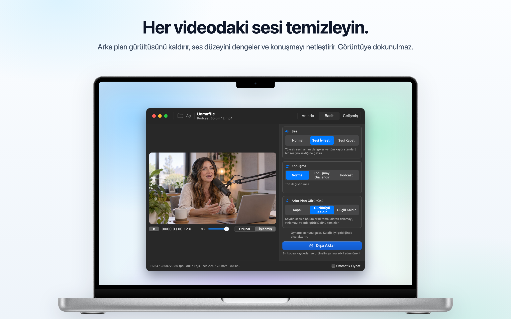
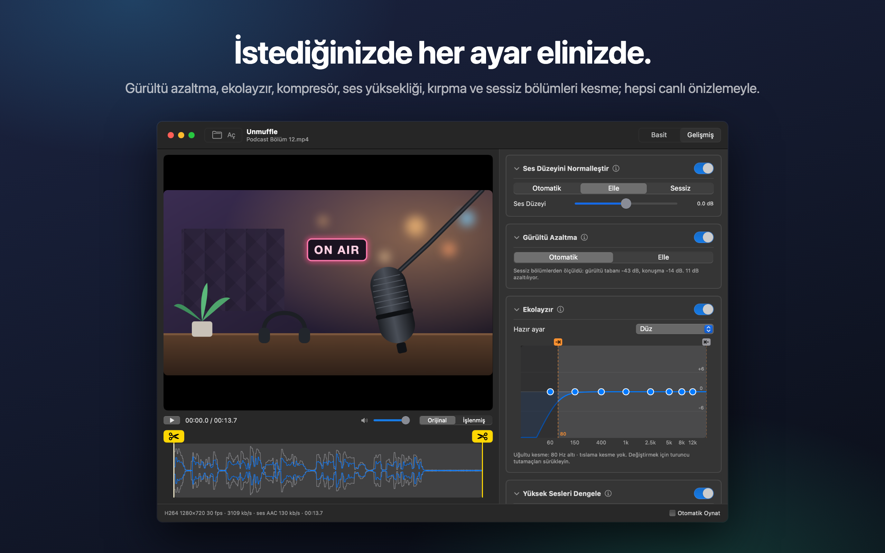
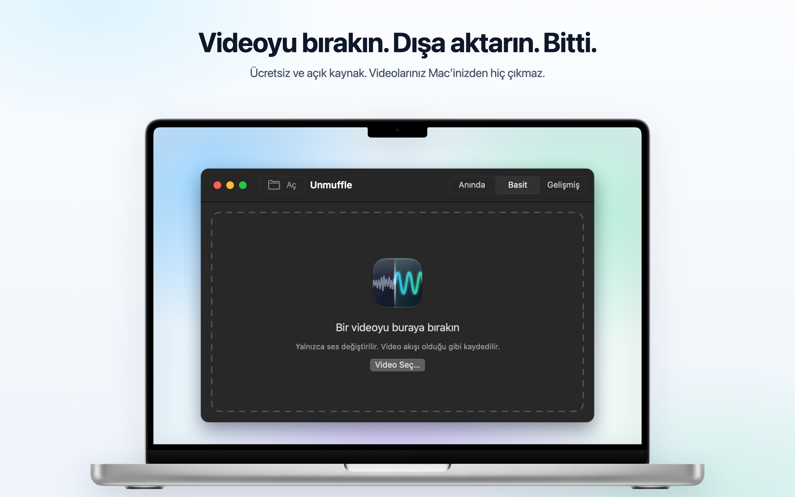

<h1 align="center">Unmuffle</h1>

<b>Her videodaki sesi temizleyin.</b> 
Arka plan gürültüsünü kaldıran, ses düzeyini dengeleyen ve konuşmayı netleştiren küçük, ücretsiz bir Mac uygulaması. 
Görüntüye dokunulmaz.

  
  
  
  

  
  &nbsp;
  

Apple Silicon ve Intel · macOS 14 veya üstü · Apple onaylı

🌐 <b>Türkçe</b> · 13 dil daha

 
🇺🇸&nbsp;<a href="README.md">English</a>&nbsp;&nbsp;·&nbsp; 🇪🇸&nbsp;<a href="README.es.md">Español</a>&nbsp;&nbsp;·&nbsp; 🇫🇷&nbsp;<a href="README.fr.md">Français</a>&nbsp;&nbsp;·&nbsp; 🇩🇪&nbsp;<a href="README.de.md">Deutsch</a>&nbsp;&nbsp;·&nbsp; 🇮🇹&nbsp;<a href="README.it.md">Italiano</a>&nbsp;&nbsp;·&nbsp; 🇧🇷&nbsp;<a href="README.pt-BR.md">Português</a>&nbsp;&nbsp;·&nbsp; 🇳🇱&nbsp;<a href="README.nl.md">Nederlands</a> 
🇵🇱&nbsp;<a href="README.pl.md">Polski</a>&nbsp;&nbsp;·&nbsp; 🇷🇺&nbsp;<a href="README.ru.md">Русский</a>&nbsp;&nbsp;·&nbsp; 🇯🇵&nbsp;<a href="README.ja.md">日本語</a>&nbsp;&nbsp;·&nbsp; 🇰🇷&nbsp;<a href="README.ko.md">한국어</a>&nbsp;&nbsp;·&nbsp; 🇨🇳&nbsp;<a href="README.zh-Hans.md">简体中文</a>&nbsp;&nbsp;·&nbsp; 🇹🇼&nbsp;<a href="README.zh-Hant.md">繁體中文</a>

## Ne yapar

Bir ekran kaydını, vlog'u ya da görüntülü görüşmeyi bırakın. Unmuffle sesi temizler ve bir kopya kaydeder.
Orijinal olduğu gibi kalır.

<table>
<tr>
<td width="33%" valign="top">
<h3>🔇 Gürültüyü kaldırır</h3>
Tıslama, vınlama ve oda gürültüsü. Güçlü ayar, sözcükler arasındaki boşlukları da sessize alır.
</td>
<td width="33%" valign="top">
<h3>🎙️ Daha net konuşma</h3>
Yüksek sesli anları dengeler, kaydı standart bir ses yüksekliğine getirir ve konuşma frekanslarını güçlendirebilir.
</td>
<td width="33%" valign="top">
<h3>🎬 Görüntüye dokunulmaz</h3>
Bir şey kesmediğiniz sürece video akışı bayt bayt kopyalanır.
</td>
</tr>
<tr>
<td valign="top">
<h3>✂️ Kırpar</h3>
Kırpmak için tutamaçları sürükleyin ya da sessiz bölümleri Unmuffle bulsun ve kessin.
</td>
<td valign="top">
<h3>🔒 Gizlilik</h3>
Her şey Mac'inizde gerçekleşir. Hiçbir şey internete yüklenmez, hesap ya da takip yoktur.
</td>
<td valign="top">
<h3>🔄 Kendini günceller</h3>
Yeni bir sürüm çıktığında bir bildirim sizi haberdar eder. Tek tıkla yüklenir.
</td>
</tr>
</table>

<table>
<tr>
<td></td>
<td></td>
</tr>
<tr>
<td align="center">Gelişmiş mod tüm ayarları gösterir</td>
<td align="center">Başlamak için bir video bırakın</td>
</tr>
</table>

## Kurulum

**Mac App Store:** [Unmuffle'ı Mac App Store'dan](https://apps.apple.com/app/unmuffle/id6825195286) indirin.
App Store uygulamayı güncel tutar.

**GitHub:**

1. [`Unmuffle.zip`](https://github.com/iAlborz/Unmuffle/releases/latest/download/Unmuffle.zip) dosyasını
   indirin ve `Unmuffle.app` uygulamasını Uygulamalar klasörüne sürükleyin. İhtiyaç duyduğu her şey içinde.
2. Uygulamayı açın. Apple tarafından onaylandığı (notarize edildiği) için macOS onu uyarı göstermeden açar.

GitHub sürümü 1.3'ten itibaren kendini günceller. Yeni bir sürüm çıktığında pencerenin üstünde bir
bildirim belirir. **Güncelle** düğmesine tıklayın; Unmuffle yeni sürümü indirir, yükler ve yeniden açılır.
Ayrıca dilediğiniz zaman **Unmuffle → Güncellemeleri Denetle…** komutunu seçebilirsiniz.

## Nasıl kullanılır

**Anında modu** en hızlısıdır. Pencereye bir ya da birkaç video bırakın (veya ⌘O tuşlarına basın). Her
biri sağdaki seçeneklerle temizlenir ve orijinalin yanına `ad-1.mp4` olarak kaydedilir. Onaylamanız
gereken bir şey yoktur. Mac App Store sürümü, kaydetmek için her klasörde bir kez izin ister.

Pencereye bir video bırakın (veya ⌘O tuşlarına basın). Varsayılan mod olan Basit modda video, temizlenmiş
sesle oynatılmaya başlar; böylece sonucu hemen duyarsınız. **Dışa Aktar** düğmesine basın ve nereye
kaydedileceğini onaylayın. Uygulama orijinalin yanında `ad-1.mp4` adını önerir (sonra `ad-2` ve
devamı). Oynatmayı kendiniz başlatmak isterseniz sağ alttaki **Otomatik Oynat** seçeneğini kapatın.

**Basit mod**, birlikte çalışan üç seçenek sunar:

- **Ses:** kaydedildiği gibi kalır, yüksek sesli anlar dengelenip standart bir ses yüksekliğine getirilir ya da ses kapatılır.
- **Konuşma:** değişiklik yok, konuşma frekansları güçlendirilip ses öne çıkarılır ya da daha dolgun bir podcast tonu verilir.
- **Arka Plan Gürültüsü:** kapalı, tıslama, vınlama ve oda gürültüsü kaldırılır ya da gürültü güçlü biçimde
  kaldırılıp sözcükler arasındaki boşluklar da sessize alınır.

Seçimleriniz uygulama açık kaldığı sürece korunur. Bir grup kayıt için yapmanız gereken tek şey: bırak,
Dışa Aktar, bırak, Dışa Aktar.

<b>Gelişmiş mod</b>

- Gürültü azaltma, gürültü kapısı, uğultu ve tıslama kesme, 8 bantlı ekolayzır, kompresör, kazanç ve ses
  yüksekliği normalleştirme. Her kartta, ayarlarını açıklayan bir ⓘ düğmesi var.
- **Gürültüyü Algıla**, gürültü tabanını ve konuşma düzeyini ölçer ve makul değerler ayarlar.
- Oynatıcıda **Orijinal** ile **İşlenmiş** arasında geçiş yapın. İşlenmiş seçiliyken ses, oynatma
  imlecinden başlayarak dışa aktarmada kullanılan ffmpeg filtre zincirinin aynısından geçer. Ses çalarken
  bir ayarı değiştirirseniz ses bir an sonra buna uyar.
- Ekolayzır sekiz noktalı bir grafiktir. Bir noktayı yukarı ya da aşağı sürükleyin; sıfırlamak için çift
  tıklayın.
- Kırpmak için dalga biçimindeki sarı makaslı tutamaçları sürükleyin.
- **Sessiz Bölümleri Kırp** sessizlikleri bulur. Kırmızı bloklar kaldırılır. Bir bloğu korumak için
  üzerine tıklayın.

<b>Gürültü azaltma nasıl çalışır</b>

Gürültü azaltmada ffmpeg'in spektral (FFT) gürültü azaltıcısı olan `afftdn` filtresi kullanılır. Bu
filtre, ses çalarken gürültü profilini sürekli izler. “Gürültüyü Algıla”, zaman çizelgesinde bulunan
sessiz bölümleri ölçer ve bunların medyan düzeyini gürültü tabanı olarak alır. Ardından azaltma miktarını
gürültü tabanı ile konuşma düzeyi arasındaki farka göre ayarlar.

<b>Video kalitesi</b>

- Kesim yoksa video akışı **olduğu gibi kopyalanır** (stream copy). Kaynakla bayt bayt aynıdır.
- Kırpma ya da sessizlik kesimleri zaman çizelgesini değiştirdiği için videonun yeniden kodlanması
  gerekir. Bunu Mac'in donanım video kodlayıcısı, kaynakla aynı kodek ve bit hızıyla yapar. “Kayıpsız
  kırpma” ise yeniden kodlamadan anahtar karelerden keser; bu yüzden kesim noktaları birkaç kare
  kayabilir.

## Geliştiriciler için

Unmuffle'ı kaynak koddan derlemek, yeni bir sürüm yayımlamak ya da katkıda bulunmak için
[İngilizce README](README.md#build-from-source) dosyasına bakın. Issue ve pull request'lerinizi bekliyoruz.

## Gizlilik

Unmuffle hiçbir veri toplamaz ve videolarınız Mac'inizden hiç çıkmaz. GitHub sürümü, yeni bir sürüm olup
olmadığını görmek için günde yaklaşık bir kez GitHub'a bakar; App Store sürümü hiçbir ağ bağlantısı
kurmaz. Ayrıntılar için [gizlilik politikasına](PRIVACY.md) (İngilizce) bakın.

## Lisans

[MIT](LICENSE). Kullanın, değiştirin, fork'layın, dağıtın.

Unmuffle, [LGPL 2.1 veya sonrası](https://www.gnu.org/licenses/old-licenses/lgpl-2.1.html) lisanslı
[FFmpeg](https://ffmpeg.org) 9.0.2'yi içerir. FFmpeg, değiştirilmemiş resmi kaynak kodundan
[`scripts/build-ffmpeg.sh`](scripts/build-ffmpeg.sh) ile derlenir. GPL ya da özgür olmayan hiçbir bileşen
etkinleştirilmez. Uygulamanın içinde ayrı kütüphaneler olarak yer alır. Lisans metni uygulamada
`Contents/Resources/FFmpeg-LICENSE.txt` konumundadır. FFmpeg, Fabrice Bellard'ın ticari markasıdır.

GitHub sürümü, güncellemeler için [MIT lisansıyla](https://github.com/sparkle-project/Sparkle/blob/2.x/LICENSE)
dağıtılan [Sparkle](https://sparkle-project.org) çerçevesini içerir. Lisans metni uygulamada
`Contents/Resources/Sparkle-LICENSE.txt` konumundadır.
