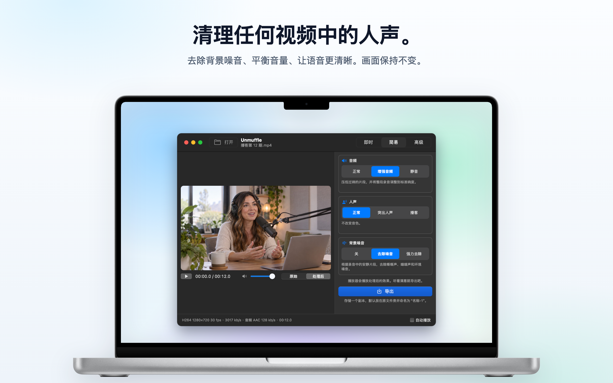
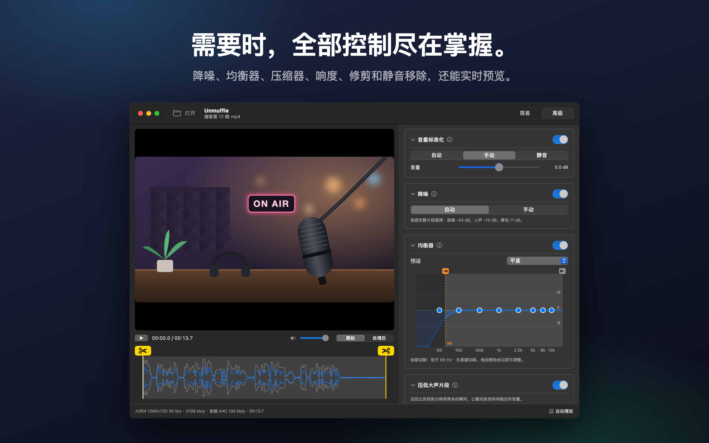
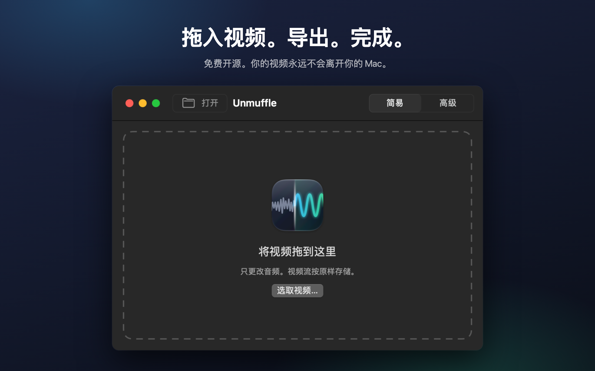

<h1 align="center">Unmuffle</h1>

<b>清理任何视频中的人声。</b> 
一款小巧的免费 Mac 应用，能去除背景噪音、平衡音量，让语音更清晰。 
画面保持不变。

  
  
  
  

  
  &nbsp;
  

支持 Apple Silicon 和 Intel · macOS 14 或更高版本 · 已通过 Apple 公证

🌐 <b>简体中文</b> · 其他 13 种语言

 
🇺🇸&nbsp;<a href="README.md">English</a>&nbsp;&nbsp;·&nbsp; 🇪🇸&nbsp;<a href="README.es.md">Español</a>&nbsp;&nbsp;·&nbsp; 🇫🇷&nbsp;<a href="README.fr.md">Français</a>&nbsp;&nbsp;·&nbsp; 🇩🇪&nbsp;<a href="README.de.md">Deutsch</a>&nbsp;&nbsp;·&nbsp; 🇮🇹&nbsp;<a href="README.it.md">Italiano</a>&nbsp;&nbsp;·&nbsp; 🇧🇷&nbsp;<a href="README.pt-BR.md">Português</a>&nbsp;&nbsp;·&nbsp; 🇳🇱&nbsp;<a href="README.nl.md">Nederlands</a> 
🇵🇱&nbsp;<a href="README.pl.md">Polski</a>&nbsp;&nbsp;·&nbsp; 🇷🇺&nbsp;<a href="README.ru.md">Русский</a>&nbsp;&nbsp;·&nbsp; 🇹🇷&nbsp;<a href="README.tr.md">Türkçe</a>&nbsp;&nbsp;·&nbsp; 🇯🇵&nbsp;<a href="README.ja.md">日本語</a>&nbsp;&nbsp;·&nbsp; 🇰🇷&nbsp;<a href="README.ko.md">한국어</a>&nbsp;&nbsp;·&nbsp; 🇹🇼&nbsp;<a href="README.zh-Hant.md">繁體中文</a>

## 功能

拖入屏幕录像、Vlog 或视频通话，Unmuffle 会清理声音并存储一个副本。原文件保持不变。

<table>
<tr>
<td width="33%" valign="top">
<h3>🔇 去除噪音</h3>
去除嘶嘶声、嗡嗡声和环境噪音。强力去除时，还会把词与词之间的间隙静音。
</td>
<td width="33%" valign="top">
<h3>🎙️ 人声更清晰</h3>
压低过响的片段，把录音调整到标准响度，还能突出语音频段。
</td>
<td width="33%" valign="top">
<h3>🎬 画面不受影响</h3>
只要不剪切，视频流就会逐字节原样复制。
</td>
</tr>
<tr>
<td valign="top">
<h3>✂️ 修剪</h3>
拖动手柄即可修剪，也可以让 Unmuffle 找出安静片段并剪掉。
</td>
<td valign="top">
<h3>🔒 注重隐私</h3>
所有处理都在你的 Mac 上完成。不上传任何内容，没有账户，也没有跟踪。
</td>
<td valign="top">
<h3>🔄 自动更新</h3>
有新版本时会显示横幅提示，点按一下即可安装。
</td>
</tr>
</table>

<table>
<tr>
<td></td>
<td></td>
</tr>
<tr>
<td align="center">高级模式会显示所有设置</td>
<td align="center">拖入视频即可开始</td>
</tr>
</table>

## 安装

**Mac App Store**：[在 Mac App Store 获取 Unmuffle](https://apps.apple.com/app/unmuffle/id6825195286)。App Store 会自动为你更新。

**GitHub**：

1. 下载 [`Unmuffle.zip`](https://github.com/iAlborz/Unmuffle/releases/latest/download/Unmuffle.zip)，然后将 `Unmuffle.app` 拖到“应用程序”文件夹。所需的一切都已内置。
2. 打开应用。它已通过 Apple 公证，所以 macOS 打开时不会显示警告。

从 1.3 版开始，GitHub 版本会自动更新。有新版本时，窗口顶部会出现横幅。点按**更新**，Unmuffle 就会下载、安装并重新启动。你也可以随时选择**Unmuffle → 检查更新…**。

## 使用方法

**即时模式**最快捷。把一个或多个视频拖到窗口上（或按下 ⌘O），每个视频都会按右侧的选项清理，并以 `名称-1.mp4` 存储在原文件旁。无需任何确认。Mac App Store 版本会在每个文件夹第一次存储时请求一次权限。

把视频拖到窗口上（或按下 ⌘O）。在默认的简易模式下，视频会以清理后的声音开始播放，你可以马上听到效果。点按**导出**并确认存储位置。它会建议在原文件旁存储为 `名称-1.mp4`（之后依次为 `名称-2` 等）。如果你想自己开始播放，可以关闭右下角的**自动播放**。

**简易模式**有三个选项，可以搭配使用：

- **音频**：保持原样；压低过响的片段并调整到标准响度；或者静音。
- **人声**：不做更改；突出语音频段，让人声更清楚；或者使用更饱满的播客音色。
- **背景噪音**：关闭；去除嘶嘶声、嗡嗡声和环境噪音；或者强力去除，并把词与词之间的间隙静音。

应用打开期间，选项会一直保留，所以处理一批录音只需要：拖入、导出、拖入、导出。

<b>高级模式</b>

- 降噪、噪音门、低频和高频切除、8 频段均衡器、压缩器、增益和响度标准化。每张卡片都有一个 ⓘ 按钮，用来说明它的设置。
- **检测噪音**会测量底噪和语音电平，并设置合适的数值。
- 播放器可以在**原始**和**处理后**之间切换。“处理后”会从播放头位置开始，让音频经过与导出时相同的 ffmpeg 滤镜链实时播放。播放时更改设置，声音片刻后就会随之变化。
- 均衡器是一个有八个点的图表。上下拖动一个点即可调整，连按可将其复位。
- 拖动波形上黄色的剪刀手柄即可修剪。
- **剪掉安静片段**会找出无声的部分。红色块会被移除，点按某个块可将其保留。

<b>降噪的原理</b>

降噪使用的是 ffmpeg 的 `afftdn`，这是一种频谱（FFT）降噪器。它会在音频播放时持续跟踪噪音特征。“检测噪音”会测量时间线上找到的安静片段，把它们电平的中位数作为底噪，再根据底噪与人声电平之间的差距设置降噪量。

<b>视频质量</b>

- 没有剪切时，视频流会**原样复制**（stream copy），与源文件逐字节完全相同。
- 修剪或剪掉静音会改变时间线，因此视频必须重新编码。Mac 的硬件视频编码器会以与源文件相同的编解码器和码率重新编码。如果改用“无损修剪”，则会在关键帧处剪切而不重新编码，因此剪切点可能会偏差几帧。

## 面向开发者

如需从源代码构建 Unmuffle、发布新版本或参与贡献，请参阅[英文 README](README.md#build-from-source)。欢迎提交 Issue 和 Pull Request。

## 隐私

Unmuffle 不收集任何数据，你的视频也永远不会离开你的 Mac。GitHub 版本大约每天向 GitHub 检查一次是否有新版本；App Store 版本不进行任何网络连接。请参阅[隐私政策](PRIVACY.md)（英文）。

## 许可证

[MIT](LICENSE)。随意使用、修改、Fork 和发布。

Unmuffle 包含 [FFmpeg](https://ffmpeg.org) 9.0.2，采用 [LGPL 2.1 或更高版本](https://www.gnu.org/licenses/old-licenses/lgpl-2.1.html)许可证。它由 [`scripts/build-ffmpeg.sh`](scripts/build-ffmpeg.sh) 从未经修改的官方源代码构建，未启用任何 GPL 或非自由组件，并以独立库的形式随应用提供。许可证文本位于应用内的 `Contents/Resources/FFmpeg-LICENSE.txt`。FFmpeg 是 Fabrice Bellard 的商标。

GitHub 版本包含用于更新的 [Sparkle](https://sparkle-project.org)，采用 [MIT 许可证](https://github.com/sparkle-project/Sparkle/blob/2.x/LICENSE)。其许可证文本位于应用内的 `Contents/Resources/Sparkle-LICENSE.txt`。
