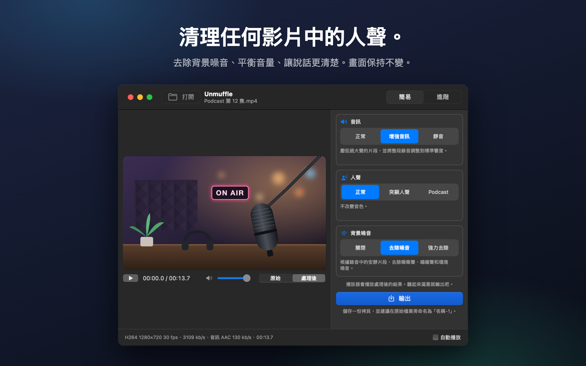
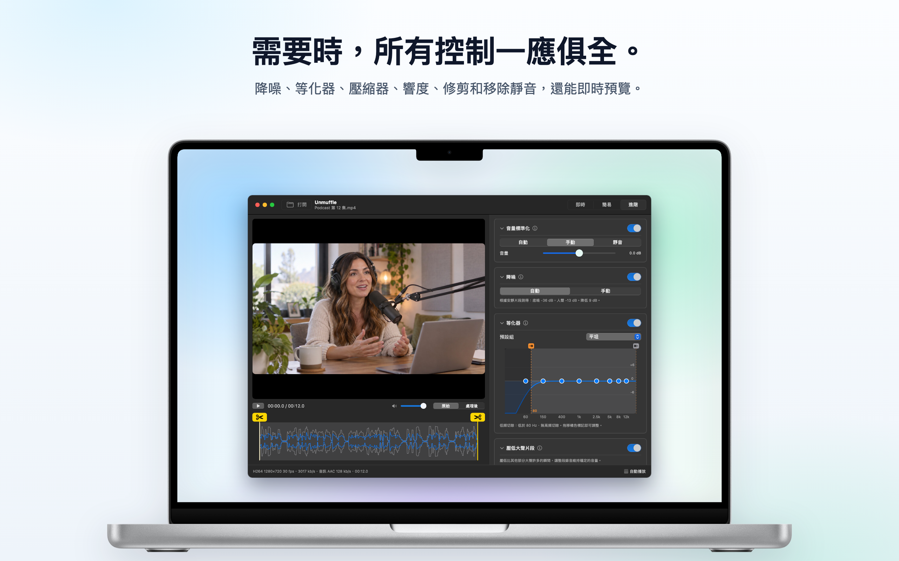
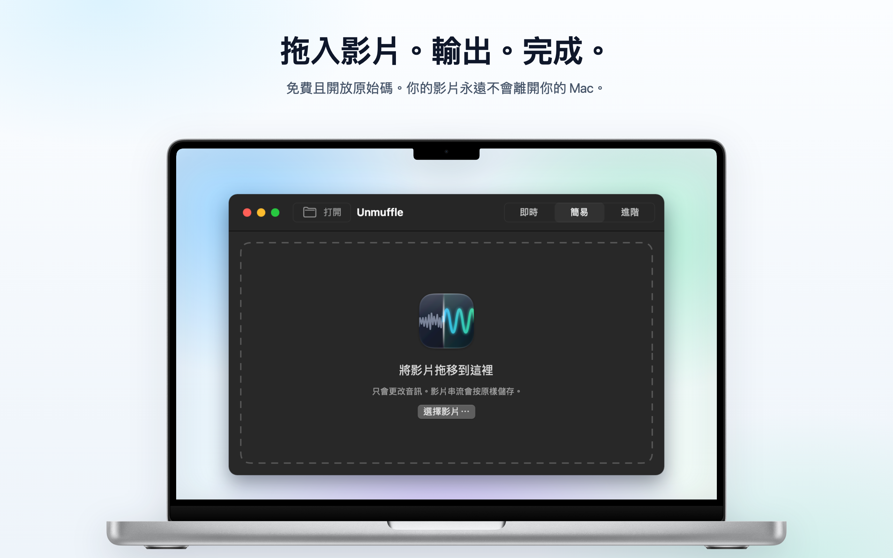

<h1 align="center">Unmuffle</h1>

<b>清理任何影片中的人聲。</b> 
一款小巧的免費 Mac App，能去除背景噪音、平衡音量，讓說話更清楚。 
畫面保持不變。

  
  
  
  

  
  &nbsp;
  

支援 Apple Silicon 和 Intel · macOS 14 或以上版本 · 已通過 Apple 公證

🌐 <b>繁體中文</b> · 其他 13 種語言

 
🇺🇸&nbsp;<a href="README.md">English</a>&nbsp;&nbsp;·&nbsp; 🇪🇸&nbsp;<a href="README.es.md">Español</a>&nbsp;&nbsp;·&nbsp; 🇫🇷&nbsp;<a href="README.fr.md">Français</a>&nbsp;&nbsp;·&nbsp; 🇩🇪&nbsp;<a href="README.de.md">Deutsch</a>&nbsp;&nbsp;·&nbsp; 🇮🇹&nbsp;<a href="README.it.md">Italiano</a>&nbsp;&nbsp;·&nbsp; 🇧🇷&nbsp;<a href="README.pt-BR.md">Português</a>&nbsp;&nbsp;·&nbsp; 🇳🇱&nbsp;<a href="README.nl.md">Nederlands</a> 
🇵🇱&nbsp;<a href="README.pl.md">Polski</a>&nbsp;&nbsp;·&nbsp; 🇷🇺&nbsp;<a href="README.ru.md">Русский</a>&nbsp;&nbsp;·&nbsp; 🇹🇷&nbsp;<a href="README.tr.md">Türkçe</a>&nbsp;&nbsp;·&nbsp; 🇯🇵&nbsp;<a href="README.ja.md">日本語</a>&nbsp;&nbsp;·&nbsp; 🇰🇷&nbsp;<a href="README.ko.md">한국어</a>&nbsp;&nbsp;·&nbsp; 🇨🇳&nbsp;<a href="README.zh-Hans.md">简体中文</a>

## 功能

拖入螢幕錄影、Vlog 或視訊通話，Unmuffle 會清理聲音並儲存一份拷貝。原始檔案保持不變。

<table>
<tr>
<td width="33%" valign="top">
<h3>🔇 去除噪音</h3>
去除嘶嘶聲、嗡嗡聲和環境噪音。強力去除時，還會將字詞之間的空隙靜音。
</td>
<td width="33%" valign="top">
<h3>🎙️ 人聲更清楚</h3>
壓低過大聲的片段，將錄音調整到標準響度，還能突顯說話的頻段。
</td>
<td width="33%" valign="top">
<h3>🎬 畫面不受影響</h3>
只要不剪切，影片串流就會逐位元組原樣拷貝。
</td>
</tr>
<tr>
<td valign="top">
<h3>✂️ 修剪</h3>
拖移控點即可修剪，也可以讓 Unmuffle 找出安靜片段並剪掉。
</td>
<td valign="top">
<h3>🔒 重視隱私</h3>
所有處理都在你的 Mac 上完成。不會上傳任何內容，沒有帳號，也沒有追蹤。
</td>
<td valign="top">
<h3>🔄 自動更新</h3>
有新版本時會顯示橫幅通知，按一下就能安裝。
</td>
</tr>
</table>

<table>
<tr>
<td></td>
<td></td>
</tr>
<tr>
<td align="center">進階模式會顯示所有設定</td>
<td align="center">拖入影片即可開始</td>
</tr>
</table>

## 安裝

**Mac App Store**：[在 Mac App Store 取得 Unmuffle](https://apps.apple.com/app/unmuffle/id6825195286)。App Store 會自動為你更新。

**GitHub**：

1. 下載 [`Unmuffle.zip`](https://github.com/iAlborz/Unmuffle/releases/latest/download/Unmuffle.zip)，然後將 `Unmuffle.app` 拖移到「應用程式」檔案夾。需要的一切都已內建。
2. 打開 App。它已通過 Apple 公證，所以 macOS 打開時不會顯示警告。

從 1.3 版開始，GitHub 版本會自動更新。有新版本時，視窗頂部會出現橫幅。按一下**更新**，Unmuffle 就會下載、安裝並重新開啟。你也可以隨時選擇**Unmuffle → 檢查更新項目⋯**。

## 使用方式

**即時模式**最快速。將一部或多部影片拖到視窗上（或按下 ⌘O），每部影片都會依右側的選項清理，並以 `名稱-1.mp4` 儲存在原始檔案旁。完全不用確認。Mac App Store 版本會在每個檔案夾第一次儲存時要求一次權限。

將影片拖到視窗上（或按下 ⌘O）。在預設的簡易模式下，影片會以清理後的聲音開始播放，讓你馬上聽到效果。按一下**輸出**並確認儲存位置。它會建議在原始檔案旁儲存為 `名稱-1.mp4`（之後依序為 `名稱-2` 等）。如果你想自己開始播放，可以關閉右下角的**自動播放**。

**簡易模式**有三個選項，可以搭配使用：

- **音訊**：保持原樣；壓低過大聲的片段並調整到標準響度；或是靜音。
- **人聲**：不做更改；突顯說話的頻段，讓人聲更清楚；或是使用更飽滿的 Podcast 音色。
- **背景噪音**：關閉；去除嘶嘶聲、嗡嗡聲和環境噪音；或是強力去除，並將字詞之間的空隙靜音。

App 開啟期間，選項會一直保留，所以處理一批錄音只要：拖入、輸出、拖入、輸出。

<b>進階模式</b>

- 降噪、噪音閘、低頻和高頻切除、8 頻段等化器、壓縮器、增益和響度標準化。每張卡片都有一個 ⓘ 按鈕，說明該卡片的設定。
- **偵測噪音**會測量底噪和說話的音量，並設定合適的數值。
- 播放器可以在**原始**和**處理後**之間切換。「處理後」會從播放磁頭的位置開始，讓音訊通過與輸出時相同的 ffmpeg 濾鏡鏈即時播放。播放時更改設定，聲音稍後就會跟著改變。
- 等化器是一張有八個點的圖表。將點往上或往下拖移即可調整，按兩下可將其重置。
- 拖移波形上黃色的剪刀控點即可修剪。
- **剪掉安靜片段**會找出無聲的部分。紅色區塊會被移除，按一下區塊即可保留。

<b>降噪的運作方式</b>

降噪使用的是 ffmpeg 的 `afftdn`，這是一種頻譜（FFT）降噪器。它會在音訊播放時持續追蹤噪音特徵。「偵測噪音」會測量時間列上找到的安靜片段，將它們音量的中位數作為底噪，再根據底噪與人聲音量之間的差距設定降噪量。

<b>影片品質</b>

- 沒有剪切時，影片串流會**原樣拷貝**（stream copy），與來源檔案逐位元組完全相同。
- 修剪或剪掉靜音會改變時間列，因此影片必須重新編碼。Mac 的硬體影片編碼器會以與來源檔案相同的編解碼器和位元速率重新編碼。如果改用「無損修剪」，則會在關鍵影格剪切而不重新編碼，因此剪切點可能會偏移幾個影格。

## 給開發者

如需從原始碼建置 Unmuffle、發布新版本或參與貢獻，請參閱[英文版 README](README.md#build-from-source)。歡迎提交 Issue 和 Pull Request。

## 隱私

Unmuffle 不會收集任何資料，你的影片也永遠不會離開你的 Mac。GitHub 版本大約每天向 GitHub 檢查一次是否有新版本；App Store 版本不會建立任何網路連線。請參閱[隱私權政策](PRIVACY.md)（英文）。

## 授權條款

[MIT](LICENSE)。歡迎自由使用、修改、Fork 和發布。

Unmuffle 包含 [FFmpeg](https://ffmpeg.org) 9.0.2，採用 [LGPL 2.1 或以上版本](https://www.gnu.org/licenses/old-licenses/lgpl-2.1.html)授權。它由 [`scripts/build-ffmpeg.sh`](scripts/build-ffmpeg.sh) 從未經修改的官方原始碼建置，未啟用任何 GPL 或非自由元件，並以獨立函式庫的形式隨 App 提供。授權條款文字位於 App 內的 `Contents/Resources/FFmpeg-LICENSE.txt`。FFmpeg 是 Fabrice Bellard 的商標。

GitHub 版本包含用於更新的 [Sparkle](https://sparkle-project.org)，採用 [MIT 授權條款](https://github.com/sparkle-project/Sparkle/blob/2.x/LICENSE)。其授權條款文字位於 App 內的 `Contents/Resources/Sparkle-LICENSE.txt`。
